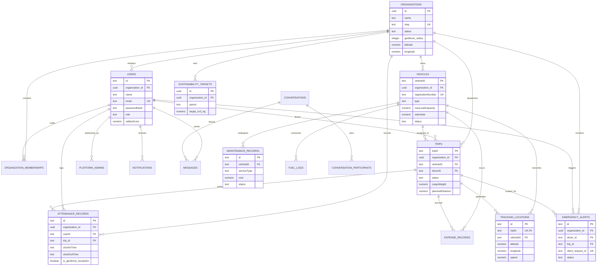

# LogiSphere AI: System Evidence and Architecture Report

**Project Title:** LogiSphere AI: AI-Powered Smart Logistics and Fleet Management System  
**Report Type:** B.Tech Project Verification & Read-Only Evidence Document  
**Repository Root:** `/Users/sakshamojha/Documents/Projects/Minor`  
**Generated Date:** 2026-10-22  
**Target Environment:** Node.js v20.20.2, npm v10.8.2, macOS Darwin  

---

## 1. STACK AND VERSIONS

The exact framework and package versions inspected directly from [app/package.json](file:///Users/sakshamojha/Documents/Projects/Minor/app/package.json) and [backend/package.json](file:///Users/sakshamojha/Documents/Projects/Minor/backend/package.json):

| Technology / Library | Layer | Package / Runtime Name | Exact Version in Codebase | Source File & Line |
| :--- | :--- | :--- | :--- | :--- |
| **Node.js** | Backend / Runtime | `node` | `v20.20.2` (Runtime) / `>=22.11.0` (App engine) | [app/package.json:57](file:///Users/sakshamojha/Documents/Projects/Minor/app/package.json#L57) |
| **React Native** | Mobile Frontend | `react-native` | `0.86.0` | [app/package.json:26](file:///Users/sakshamojha/Documents/Projects/Minor/app/package.json#L26) |
| **React** | Mobile Frontend | `react` | `19.2.3` | [app/package.json:25](file:///Users/sakshamojha/Documents/Projects/Minor/app/package.json#L25) |
| **TypeScript (Frontend)** | Mobile Dev | `typescript` | `^5.8.3` | [app/package.json:54](file:///Users/sakshamojha/Documents/Projects/Minor/app/package.json#L54) |
| **TypeScript (Backend)** | Backend Dev | `typescript` | `^5.6.2` | [backend/package.json:42](file:///Users/sakshamojha/Documents/Projects/Minor/backend/package.json#L42) |
| **React Navigation (Core)** | Mobile Nav | `@react-navigation/native` | `^7.3.14` | [app/package.json:20](file:///Users/sakshamojha/Documents/Projects/Minor/app/package.json#L20) |
| **React Navigation (Stack)** | Mobile Nav | `@react-navigation/native-stack` | `^7.18.6` | [app/package.json:21](file:///Users/sakshamojha/Documents/Projects/Minor/app/package.json#L21) |
| **React Navigation (Tabs)** | Mobile Nav | `@react-navigation/bottom-tabs` | `^7.18.14` | [app/package.json:18](file:///Users/sakshamojha/Documents/Projects/Minor/app/package.json#L18) |
| **React Navigation (Drawer)** | Mobile Nav | `@react-navigation/drawer` | `^7.13.5` | [app/package.json:19](file:///Users/sakshamojha/Documents/Projects/Minor/app/package.json#L19) |
| **Zustand** | State Store | `zustand` | `^5.0.14` | [app/package.json:34](file:///Users/sakshamojha/Documents/Projects/Minor/app/package.json#L34) |
| **Reanimated** | Animations | `react-native-reanimated` | `^4.5.3` | [app/package.json:28](file:///Users/sakshamojha/Documents/Projects/Minor/app/package.json#L28) |
| **Axios** | HTTP Client | `axios` | `^1.18.1` | [app/package.json:23](file:///Users/sakshamojha/Documents/Projects/Minor/app/package.json#L23) |
| **AsyncStorage** | Local Storage | `@react-native-async-storage/async-storage` | `^3.1.1` | [app/package.json:14](file:///Users/sakshamojha/Documents/Projects/Minor/app/package.json#L14) |
| **Geolocation Library** | Device GPS | `@react-native-community/geolocation` | `^3.4.0` | [app/package.json:15](file:///Users/sakshamojha/Documents/Projects/Minor/app/package.json#L15) |
| **Map Rendering** | Vector Maps | `@maplibre/maplibre-react-native` | `^11.3.6` | [app/package.json:13](file:///Users/sakshamojha/Documents/Projects/Minor/app/package.json#L13) |
| **Express** | Backend Server | `express` | `^4.21.0` | [backend/package.json:20](file:///Users/sakshamojha/Documents/Projects/Minor/backend/package.json#L20) |
| **Supabase Client (Backend)** | DB / Realtime | `@supabase/supabase-js` | `^2.45.4` | [backend/package.json:14](file:///Users/sakshamojha/Documents/Projects/Minor/backend/package.json#L14) |
| **Supabase Client (App)** | Client DB | `@supabase/supabase-js` | `^2.109.0` | [app/package.json:22](file:///Users/sakshamojha/Documents/Projects/Minor/app/package.json#L22) |
| **Vitest** | Test Runner | `vitest` | `^2.1.9` | [backend/package.json:43](file:///Users/sakshamojha/Documents/Projects/Minor/backend/package.json#L43) |
| **Supertest** | API Testing | `supertest` | `^7.3.0` | [backend/package.json:40](file:///Users/sakshamojha/Documents/Projects/Minor/backend/package.json#L40) |
| **JWT Library** | Auth Tokens | `jsonwebtoken` | `^9.0.2` | [backend/package.json:22](file:///Users/sakshamojha/Documents/Projects/Minor/backend/package.json#L22) |
| **Password Hashing** | Cryptography | `bcryptjs` | `^2.4.3` | [backend/package.json:17](file:///Users/sakshamojha/Documents/Projects/Minor/backend/package.json#L17) |
| **PDF Generation** | Attendance Exports | `pdfkit` | `^0.20.2` | [backend/package.json:25](file:///Users/sakshamojha/Documents/Projects/Minor/backend/package.json#L25) |
| **WebSockets** | Realtime Ingestion | `ws` | `^8.21.3` | [backend/package.json:27](file:///Users/sakshamojha/Documents/Projects/Minor/backend/package.json#L27) |
| **Schema Validation** | Env Config | `zod` | `^3.23.8` | [backend/package.json:28](file:///Users/sakshamojha/Documents/Projects/Minor/backend/package.json#L28) |

---

## 2. MODULE STATUS TABLE

Status categories strictly evaluated against code evidence:
- **Implemented and verified**: Full backend implementation, frontend integration, and passed automated integration tests.
- **Implemented not fully tested**: Full code exists across frontend/backend, but automated tests have gaps or minor edge cases.
- **Partially implemented**: Subset of features implemented (e.g. offline queue only for SOS; attendance exception only for active trips).
- **Mock/static-data based**: Returns canned responses or uses regex mock readers without production SDK.
- **Not implemented/planned**: Stated in roadmap or requirements but zero production code exists.

| # | Module Name | Status | Main Files | Screens | API Routes | DB Tables | What is Mocked or Hard-Coded |
| :--- | :--- | :--- | :--- | :--- | :--- | :--- | :--- |
| 1 | **Authentication / RBAC** | Implemented and verified | [auth.ts](file:///Users/sakshamojha/Documents/Projects/Minor/backend/src/middleware/auth.ts), [permissions.ts](file:///Users/sakshamojha/Documents/Projects/Minor/backend/src/config/permissions.ts), [AuthStore.ts](file:///Users/sakshamojha/Documents/Projects/Minor/app/src/store/AuthStore.ts) | `LoginScreen.tsx`, `SignupScreen.tsx` | `POST /api/auth/login`, `POST /api/auth/change-password`, `POST /api/user/create` | `users`, `organization_memberships` | Default fallback JWT secret `'development-secret'` in [env.ts:13](file:///Users/sakshamojha/Documents/Projects/Minor/backend/src/config/env.ts#L13); default org ID `'00000000-0000-0000-0000-000000000001'`. |
| 2 | **Vehicles** | Implemented and verified | [vehicles/routes.ts](file:///Users/sakshamojha/Documents/Projects/Minor/backend/src/modules/vehicles/routes.ts), [VehicleStore.ts](file:///Users/sakshamojha/Documents/Projects/Minor/app/src/store/VehicleStore.ts) | `VehicleRegistryScreen.tsx` | `GET /api/vehicle`, `POST /api/vehicle/create`, `PUT /api/vehicle/update`, `DELETE /api/vehicle/delete` | `vehicles` | None; live database CRUD with payload validation. |
| 3 | **Drivers (incl. Manual Add)** | Implemented and verified | [users/routes.ts](file:///Users/sakshamojha/Documents/Projects/Minor/backend/src/modules/users/routes.ts), [DriverStore.ts](file:///Users/sakshamojha/Documents/Projects/Minor/app/src/store/DriverStore.ts) | `DriversScreen.tsx`, `SignupScreen.tsx` | `GET /api/user`, `POST /api/user/create`, `PUT /api/user/update`, `DELETE /api/user/delete` | `users`, `organization_memberships` | Default initial safety score initialized to `95` in [001_initial_schema.sql:13](file:///Users/sakshamojha/Documents/Projects/Minor/backend/supabase/migrations/001_initial_schema.sql#L13). |
| 4 | **Trips** | Implemented and verified | [trips/routes.ts](file:///Users/sakshamojha/Documents/Projects/Minor/backend/src/modules/trips/routes.ts), [TripStore.ts](file:///Users/sakshamojha/Documents/Projects/Minor/app/src/store/TripStore.ts) | `TripDispatcherScreen.tsx` | `GET /api/trip`, `POST /api/trip/create`, `PUT /api/trip/:id/status`, `PUT /api/trip/dispatch/:id` | `trips`, `vehicles`, `users` | Fallback business timezone defaults to `'Asia/Kolkata'` in [trips/routes.ts:60](file:///Users/sakshamojha/Documents/Projects/Minor/backend/src/modules/trips/routes.ts#L60). |
| 5 | **GPS Live Tracking** | Implemented and verified | [tracking/routes.ts](file:///Users/sakshamojha/Documents/Projects/Minor/backend/src/modules/tracking/routes.ts), [driverTrackingService.ts](file:///Users/sakshamojha/Documents/Projects/Minor/app/src/services/tracking/driverTrackingService.ts), [LiveTrackingScreen.tsx](file:///Users/sakshamojha/Documents/Projects/Minor/app/src/screens/LiveTrackingScreen.tsx) | `LiveTrackingScreen.tsx` | `GET /api/tracking/live`, `POST /api/tracking/location`, `/ws/tracking` | `tracking_locations` | Map fallback center coordinates (`23.05288, 72.61891`) if GPS uninitialized in [LiveTrackingScreen.tsx:43](file:///Users/sakshamojha/Documents/Projects/Minor/app/src/screens/LiveTrackingScreen.tsx#L43). |
| 6 | **Geofencing Attendance** | Implemented and verified | [attendance/routes.ts](file:///Users/sakshamojha/Documents/Projects/Minor/backend/src/modules/attendance/routes.ts), [autoClockOut.ts](file:///Users/sakshamojha/Documents/Projects/Minor/backend/src/modules/attendance/autoClockOut.ts), [ClockInScreen.tsx](file:///Users/sakshamojha/Documents/Projects/Minor/app/src/screens/ClockInScreen.tsx) | `ClockInScreen.tsx`, `AttendanceReportScreen.tsx` | `GET /api/attendance/status`, `POST /api/attendance/clock-in`, `POST /api/attendance/clock-out`, `GET /api/attendance/report/export-pdf` | `attendance_records`, `organizations` | Default office coordinates fallback `23.05288, 72.61891` and radius `200m` in [env.ts:22-24](file:///Users/sakshamojha/Documents/Projects/Minor/backend/src/config/env.ts#L22-L24). |
| 7 | **Maintenance** | Implemented and verified | [maintenance/routes.ts](file:///Users/sakshamojha/Documents/Projects/Minor/backend/src/modules/maintenance/routes.ts), [MaintenanceStore.ts](file:///Users/sakshamojha/Documents/Projects/Minor/app/src/store/MaintenanceStore.ts) | `MaintenanceScreen.tsx` | `GET /api/maintenance`, `POST /api/maintenance/create`, `PUT /api/maintenance/:id/complete` | `maintenance_records`, `vehicles` | None; full live persistence and vehicle state restoration. |
| 8 | **Fuel** | Implemented and verified | [fuel/routes.ts](file:///Users/sakshamojha/Documents/Projects/Minor/backend/src/modules/fuel/routes.ts), [FuelExpenseStore.ts](file:///Users/sakshamojha/Documents/Projects/Minor/app/src/store/FuelExpenseStore.ts) | `FuelExpenseScreen.tsx` | `GET /api/fuel`, `POST /api/fuel/create` | `fuel_logs`, `vehicles` | None; verified against live database and fuel anomaly calculations. |
| 9 | **Expenses** | Implemented and verified | [expenses/routes.ts](file:///Users/sakshamojha/Documents/Projects/Minor/backend/src/modules/expenses/routes.ts), [FuelExpenseStore.ts](file:///Users/sakshamojha/Documents/Projects/Minor/app/src/store/FuelExpenseStore.ts) | `FuelExpenseScreen.tsx` | `GET /api/expenses`, `POST /api/expenses/create` | `expense_records`, `trips` | None; live database insertion and aggregation. |
| 10 | **Dashboard / Analytics** | Implemented and verified | [dashboard/routes.ts](file:///Users/sakshamojha/Documents/Projects/Minor/backend/src/modules/dashboard/routes.ts), [analytics/routes.ts](file:///Users/sakshamojha/Documents/Projects/Minor/backend/src/modules/analytics/routes.ts) | `DashboardScreen.tsx`, `AnalyticsScreen.tsx` | `GET /api/dashboard/summary`, `GET /api/analytics` | `trips`, `vehicles`, `maintenance_records`, `fuel_logs` | Default 0 KPI fallbacks when empty dataset. |
| 11 | **AI Assistant** | Implemented and verified | [ai/routes.ts](file:///Users/sakshamojha/Documents/Projects/Minor/backend/src/modules/ai/routes.ts), [geminiClient.ts](file:///Users/sakshamojha/Documents/Projects/Minor/backend/src/modules/ai/geminiClient.ts), [AIAssistantScreen.tsx](file:///Users/sakshamojha/Documents/Projects/Minor/app/src/screens/AIAssistantScreen.tsx) | `AIAssistantScreen.tsx` | `POST /api/ai/query`, `POST /api/ai/route-recommendation`, `GET /api/ai/metrics` | Read-only against `trips`, `vehicles`, `users`, `maintenance_records`, `fuel_logs` | Deterministic heuristic calculations act as zero-downtime offline fallback if Gemini API is unreachable or rate-limited. |
| 12 | **Notifications** | Implemented and verified | [notifications/routes.ts](file:///Users/sakshamojha/Documents/Projects/Minor/backend/src/modules/notifications/routes.ts), [NotificationStore.ts](file:///Users/sakshamojha/Documents/Projects/Minor/app/src/store/NotificationStore.ts) | `AlertsScreen.tsx` | `GET /api/notifications`, `PUT /api/notifications/:id/read` | `notifications` | System bootstrap notification titles; no external APNs/FCM push gateway. |
| 13 | **Emergency SOS** | Implemented and verified | [alerts/routes.ts](file:///Users/sakshamojha/Documents/Projects/Minor/backend/src/modules/alerts/routes.ts), [sosService.ts](file:///Users/sakshamojha/Documents/Projects/Minor/app/src/services/sosService.ts), [SOSButton.tsx](file:///Users/sakshamojha/Documents/Projects/Minor/app/src/components/SOSButton.tsx) | `AlertsScreen.tsx`, Top bar button on all screens | `POST /api/alerts/sos`, `POST /api/sos/trigger`, `GET /api/alerts`, `POST /api/alerts/:id/resolve` | `emergency_alerts`, `notifications` | Fallback location status `'UNAVAILABLE'` if GPS coordinates cannot be acquired. |
| 14 | **Location Search Fallback** | Implemented and verified | [locationService.ts](file:///Users/sakshamojha/Documents/Projects/Minor/app/src/services/locationService.ts), [locations/routes.ts](file:///Users/sakshamojha/Documents/Projects/Minor/backend/src/modules/locations/routes.ts) | Search modals in `TripDispatcherScreen.tsx` | `POST /api/v1/locations/autocomplete`, `GET /api/v1/locations/details/:placeId` | None (External APIs & local cache) | 10 hardcoded logistics hubs in [locationService.ts:151-232](file:///Users/sakshamojha/Documents/Projects/Minor/app/src/services/locationService.ts#L151-L232); coordinate math synthesis fallback. |
| 15 | **Predictive Maintenance** | Implemented and verified | [maintenanceForecastService.ts](file:///Users/sakshamojha/Documents/Projects/Minor/backend/src/modules/analytics/maintenanceForecastService.ts), [analytics/routes.ts](file:///Users/sakshamojha/Documents/Projects/Minor/backend/src/modules/analytics/routes.ts) | `AnalyticsScreen.tsx` | `GET /api/analytics/maintenance-forecast`, `GET /api/analytics/maintenance-forecast/:vehicleId` | `vehicles`, `maintenance_records` | Default industry baseline parameters: 15% annual wear rate, 1.25 age multiplier, 1.35 high-mileage penalty. |
| 16 | **Delay Prediction** | Implemented and verified | [delayPredictionService.ts](file:///Users/sakshamojha/Documents/Projects/Minor/backend/src/modules/trips/delayPredictionService.ts), [trips/routes.ts](file:///Users/sakshamojha/Documents/Projects/Minor/backend/src/modules/trips/routes.ts) | `TripDispatcherScreen.tsx` | `GET /api/trip/:tripID/delay-insights` | `trips`, `tracking_locations` | Hardcoded Indian city coordinate presets in [delayPredictionService.ts:24-42](file:///Users/sakshamojha/Documents/Projects/Minor/backend/src/modules/trips/delayPredictionService.ts#L24-L42). |
| 17 | **Proof of Delivery** | Not implemented/planned | NOT FOUND | NOT FOUND | NOT FOUND | NOT FOUND | Completely absent; no digital signature, recipient sign-off, or photo POD upload exists in code. |
| 18 | **Document Scanning (OCR)** | Mock/static-data based | [ocr/routes.ts](file:///Users/sakshamojha/Documents/Projects/Minor/backend/src/modules/ocr/routes.ts) | `DriversScreen.tsx` | `POST /api/ocr/scan-license` | None | Hardcoded mock OCR response in [ocr/routes.ts:10-25](file:///Users/sakshamojha/Documents/Projects/Minor/backend/src/modules/ocr/routes.ts#L10-L25); production Regula SDK reader was abandoned. |
| 19 | **Trip Replay** | Not implemented/planned | NOT FOUND | NOT FOUND | NOT FOUND | NOT FOUND | Historical route GPS breadcrumb replay/playback does not exist in mobile app or backend. |
| 20 | **Offline Sync** | Partially implemented | [offlineSOSQueue.ts](file:///Users/sakshamojha/Documents/Projects/Minor/app/src/services/offlineSOSQueue.ts), [sosSyncWorker.ts](file:///Users/sakshamojha/Documents/Projects/Minor/app/src/services/sosSyncWorker.ts) | Background sync service | `POST /api/sos/trigger` | `emergency_alerts` | Offline queue and replay engine is implemented strictly for Emergency SOS; offline sync for trips/fuel/expenses is NOT FOUND. |
| 21 | **Carbon Emissions** | Implemented and verified | [carbonService.ts](file:///Users/sakshamojha/Documents/Projects/Minor/backend/src/modules/carbon/carbonService.ts), [carbon/routes.ts](file:///Users/sakshamojha/Documents/Projects/Minor/backend/src/modules/carbon/routes.ts) | `CarbonIntelligenceScreen.tsx` | `GET /api/carbon/overview`, `GET /api/carbon/vehicles`, `GET /api/carbon/trips`, `POST /api/carbon/targets` | `trips`, `vehicles`, `fuel_logs`, `sustainability_targets` | Standard emission factor coefficients: Diesel 2.68 kg CO2/L, Petrol 2.31 kg CO2/L, CNG 2.75 kg CO2/kg, Electric 0.82 kg CO2/kWh. |

---

## 3. API ROUTES TABLE

Complete inventory of all backend HTTP routes registered in Express, inspected from [backend/src/app.ts](file:///Users/sakshamojha/Documents/Projects/Minor/backend/src/app.ts) and all module router files:

| METHOD | Full Path | Middleware (Auth / Role) | Roles Allowed | Request Fields | Response Shape | File & Line Citation |
| :--- | :--- | :--- | :--- | :--- | :--- | :--- |
| **GET** | `/health` | None | Public | None | `{ success: true, service: 'LogiSphere AI Backend' }` | [app.ts:37](file:///Users/sakshamojha/Documents/Projects/Minor/backend/src/app.ts#L37) |
| **POST** | `/api/auth/login` | None | Public | `email`, `password`, `role` (optional) | `{ success, serviceResult: { token, user, mustChangePassword } }` | [auth/routes.ts:10](file:///Users/sakshamojha/Documents/Projects/Minor/backend/src/modules/auth/routes.ts#L10) |
| **POST** | `/api/auth/change-password` | `optionalAuth` | Authenticated | `currentPassword`, `newPassword` | `{ success, message }` | [auth/routes.ts:71](file:///Users/sakshamojha/Documents/Projects/Minor/backend/src/modules/auth/routes.ts#L71) |
| **GET** | `/api/auth/request-reset-password` | None | Public | `?email=` | `{ success, message }` | [auth/routes.ts:150](file:///Users/sakshamojha/Documents/Projects/Minor/backend/src/modules/auth/routes.ts#L150) |
| **POST** | `/api/auth/request-reset-password` | None | Public | `email` | `{ success, message }` | [auth/routes.ts:156](file:///Users/sakshamojha/Documents/Projects/Minor/backend/src/modules/auth/routes.ts#L156) |
| **POST** | `/api/auth/reset-password` | None | Public | `token`, `newPassword` | `{ success, message }` | [auth/routes.ts:161](file:///Users/sakshamojha/Documents/Projects/Minor/backend/src/modules/auth/routes.ts#L161) |
| **POST** | `/api/user/create` | `optionalAuth` | Any (Unchecked) | `name`, `email`, `password`, `phoneNo`, `role`, `licenseNo`, `licenseExpiryDate` | `{ success, token, user }` (201 Created) | [users/routes.ts:47](file:///Users/sakshamojha/Documents/Projects/Minor/backend/src/modules/users/routes.ts#L47) |
| **GET** | `/api/user` | `optionalAuth` | Any | `?role=` | Array of User objects | [users/routes.ts:136](file:///Users/sakshamojha/Documents/Projects/Minor/backend/src/modules/users/routes.ts#L136) |
| **PUT** | `/api/user/update` | `optionalAuth` | Any | `id`, `name`, `email`, `phoneNo`, `role`, `status` | Updated User object | [users/routes.ts:169](file:///Users/sakshamojha/Documents/Projects/Minor/backend/src/modules/users/routes.ts#L169) |
| **DELETE** | `/api/user/delete` | `optionalAuth` | Any | `id` (in body) | Deleted User record | [users/routes.ts:235](file:///Users/sakshamojha/Documents/Projects/Minor/backend/src/modules/users/routes.ts#L235) |
| **GET** | `/api/vehicle` | `optionalAuth` | Any | None | Array of Vehicle objects | [vehicles/routes.ts:42](file:///Users/sakshamojha/Documents/Projects/Minor/backend/src/modules/vehicles/routes.ts#L42) |
| **POST** | `/api/vehicle/create` | `optionalAuth` | Any (Unchecked) | `registrationNumber`, `name`, `type`, `maxLoadCapacity`, `odometer`, `acquisitionCost` | `{ vehicle: Vehicle }` (201 Created) | [vehicles/routes.ts:99](file:///Users/sakshamojha/Documents/Projects/Minor/backend/src/modules/vehicles/routes.ts#L99) |
| **PUT** | `/api/vehicle/update` | `optionalAuth` | Any | `vehicleID`, patch fields | Updated Vehicle object | [vehicles/routes.ts:187](file:///Users/sakshamojha/Documents/Projects/Minor/backend/src/modules/vehicles/routes.ts#L187) |
| **DELETE** | `/api/vehicle/delete` | `optionalAuth` | Any | `vehicleID` (in body) | Deleted Vehicle record | [vehicles/routes.ts:264](file:///Users/sakshamojha/Documents/Projects/Minor/backend/src/modules/vehicles/routes.ts#L264) |
| **GET** | `/api/trip` | `requireOrgMembership()` | All Org Members (Filtered to Driver's own if DRIVER) | `?driverID=` | Array of Trip objects | [trips/routes.ts:21](file:///Users/sakshamojha/Documents/Projects/Minor/backend/src/modules/trips/routes.ts#L21) |
| **POST** | `/api/trip/create` | `optionalAuth` | Any (Unchecked) | `source`, `destination`, `vehicleID`, `driverID`, `cargoWeight`, `plannedDistance`, `startingOdometer` | Trip object (201 Created) | [trips/routes.ts:288](file:///Users/sakshamojha/Documents/Projects/Minor/backend/src/modules/trips/routes.ts#L288) |
| **PUT** | `/api/trip/:tripID/status` | `requireOrgMembership()` | Manager, Dispatcher, Driver (transition-dependent) | `status`, `finalOdometer`, `fuelConsumed` | Updated Trip record | [trips/routes.ts:674](file:///Users/sakshamojha/Documents/Projects/Minor/backend/src/modules/trips/routes.ts#L674) |
| **PUT** | `/api/trip/dispatch/:tripID` | `requireOrgPermission(TRIPS_DISPATCH)` | Manager, Dispatcher | None | Dispatched Trip record (`ACCEPTED`) | [trips/routes.ts:677](file:///Users/sakshamojha/Documents/Projects/Minor/backend/src/modules/trips/routes.ts#L677) |
| **PUT** | `/api/trip/complete/:tripID` | `requireOrgMembership()` | Manager, Dispatcher, Driver | `finalOdometer`, `fuelConsumed` | Completed Trip record (`DELIVERED`) | [trips/routes.ts:678](file:///Users/sakshamojha/Documents/Projects/Minor/backend/src/modules/trips/routes.ts#L678) |
| **PUT** | `/api/trip/cancel/:tripID` | `requireOrgPermission(TRIPS_CANCEL)` | Manager, Dispatcher | `reason` | Cancelled Trip record | [trips/routes.ts:679](file:///Users/sakshamojha/Documents/Projects/Minor/backend/src/modules/trips/routes.ts#L679) |
| **GET** | `/api/trip/:tripID/delay-insights` | `requireOrgMembership()` | All Org Members | None | `{ success, data: DelayInsights }` | [trips/routes.ts:682](file:///Users/sakshamojha/Documents/Projects/Minor/backend/src/modules/trips/routes.ts#L682) |
| **GET** | `/api/trip/:tripID/destination-weather` | `requireOrgMembership()` | Manager, Dispatcher, Assigned Driver | `?lat=&lon=` | `{ success, weather: WeatherData }` | [trips/routes.ts:703](file:///Users/sakshamojha/Documents/Projects/Minor/backend/src/modules/trips/routes.ts#L703) |
| **GET** | `/api/attendance/status` | `optionalAuth` | All Users | `?userId=` | `{ success, status, record, history, geofence, activeTrip }` | [attendance/routes.ts:198](file:///Users/sakshamojha/Documents/Projects/Minor/backend/src/modules/attendance/routes.ts#L198) |
| **GET** | `/api/attendance/active-trip` | `optionalAuth` | Driver | None | `{ success, hasActiveTrip, trip }` | [attendance/routes.ts:297](file:///Users/sakshamojha/Documents/Projects/Minor/backend/src/modules/attendance/routes.ts#L297) |
| **POST** | `/api/attendance/clock-in` | `optionalAuth` | Any (Driver restricted on exception) | `latitude`, `longitude`, `locationName`, `tripId`, `locationDescription` | `{ success, status, record, history, data }` | [attendance/routes.ts:422](file:///Users/sakshamojha/Documents/Projects/Minor/backend/src/modules/attendance/routes.ts#L422) |
| **POST** | `/api/attendance/clock-out` | `optionalAuth` | Any | `latitude`, `longitude`, `locationName`, `tripId`, `locationDescription` | `{ success, status, record, history, data }` | [attendance/routes.ts:640](file:///Users/sakshamojha/Documents/Projects/Minor/backend/src/modules/attendance/routes.ts#L640) |
| **POST** | `/api/attendance/reconcile` | `optionalAuth` | Any | `userId` | `{ success, reconciledCount }` | [attendance/routes.ts:871](file:///Users/sakshamojha/Documents/Projects/Minor/backend/src/modules/attendance/routes.ts#L871) |
| **GET** | `/api/attendance/history` | `optionalAuth` | Any | `?userId=&date=` | Array of Attendance records | [attendance/routes.ts:883](file:///Users/sakshamojha/Documents/Projects/Minor/backend/src/modules/attendance/routes.ts#L883) |
| **GET** | `/api/attendance/report` | `optionalAuth` | Any | `?date=&range=&userId=` | `{ summary, records, byUser }` | [attendance/routes.ts:1156](file:///Users/sakshamojha/Documents/Projects/Minor/backend/src/modules/attendance/routes.ts#L1156) |
| **GET** | `/api/attendance/report/export-pdf` | `optionalAuth` | Any | `?date=&range=&userId=` | Binary PDF document stream (`application/pdf`) | [attendance/routes.ts:1186](file:///Users/sakshamojha/Documents/Projects/Minor/backend/src/modules/attendance/routes.ts#L1186) |
| **GET** | `/api/maintenance` | `optionalAuth` | Any | None | Array of Maintenance records | [maintenance/routes.ts:46](file:///Users/sakshamojha/Documents/Projects/Minor/backend/src/modules/maintenance/routes.ts#L46) |
| **POST** | `/api/maintenance/create` | `optionalAuth` | Any (Unchecked) | `vehicleID`, `serviceType`, `cost`, `date`, `status` | `{ maintenance: MaintenanceRecord }` | [maintenance/routes.ts:88](file:///Users/sakshamojha/Documents/Projects/Minor/backend/src/modules/maintenance/routes.ts#L88) |
| **PUT** | `/api/maintenance/:id/complete` | `optionalAuth` | Any (Unchecked) | None | `{ success, record, vehicle }` | [maintenance/routes.ts:240](file:///Users/sakshamojha/Documents/Projects/Minor/backend/src/modules/maintenance/routes.ts#L240) |
| **GET** | `/api/fuel` | `optionalAuth` | Any | None | Array of Fuel logs | [fuel/routes.ts:35](file:///Users/sakshamojha/Documents/Projects/Minor/backend/src/modules/fuel/routes.ts#L35) |
| **POST** | `/api/fuel/create` | `optionalAuth` | Any (Unchecked) | `vehicleID`, `date`, `liters`, `cost` | `{ fuelLog: FuelLog }` | [fuel/routes.ts:72](file:///Users/sakshamojha/Documents/Projects/Minor/backend/src/modules/fuel/routes.ts#L72) |
| **GET** | `/api/expenses` | `optionalAuth` | Any | None | Array of Expense records | [expenses/routes.ts:38](file:///Users/sakshamojha/Documents/Projects/Minor/backend/src/modules/expenses/routes.ts#L38) |
| **POST** | `/api/expenses/create` | `optionalAuth` | Any (Unchecked) | `tripID`, `vehicleID`, `toll`, `other`, `maint` | `{ expense: ExpenseRecord }` | [expenses/routes.ts:75](file:///Users/sakshamojha/Documents/Projects/Minor/backend/src/modules/expenses/routes.ts#L75) |
| **GET** | `/api/dashboard/summary` | `optionalAuth` | Any | None | `{ fleetUtilization, activeTrips, pendingMaintenance, todayDeliveries, ... }` | [dashboard/routes.ts:13](file:///Users/sakshamojha/Documents/Projects/Minor/backend/src/modules/dashboard/routes.ts#L13) |
| **GET** | `/api/tracking/live` | `requireOrgMembership()` | All Org Members | None | `{ success, count, data: TrackingLocation[] }` | [tracking/routes.ts:33](file:///Users/sakshamojha/Documents/Projects/Minor/backend/src/modules/tracking/routes.ts#L33) |
| **GET** | `/api/tracking/:tripID` | `authenticate` | Authenticated | None | `{ success, data: TrackingLocation }` | [tracking/routes.ts:188](file:///Users/sakshamojha/Documents/Projects/Minor/backend/src/modules/tracking/routes.ts#L188) |
| **POST** | `/api/tracking/location` | `authenticate` | Assigned Driver / Manager | `tripID`, `vehicleID`, `latitude`, `longitude`, `speed`, `accuracy`, `heading` | `{ success, data: TrackingLocation }` | [tracking/routes.ts:238](file:///Users/sakshamojha/Documents/Projects/Minor/backend/src/modules/tracking/routes.ts#L238) |
| **GET** | `/api/analytics` | `optionalAuth` | Any | None | Fleet cost and operational aggregation | [analytics/routes.ts:37](file:///Users/sakshamojha/Documents/Projects/Minor/backend/src/modules/analytics/routes.ts#L37) |
| **GET** | `/api/analytics/maintenance-forecast` | `requireOrgMembership()` | Manager, Safety Officer, Finance | None | `{ success, summary, fleetForecast }` | [analytics/routes.ts:87](file:///Users/sakshamojha/Documents/Projects/Minor/backend/src/modules/analytics/routes.ts#L87) |
| **GET** | `/api/analytics/maintenance-forecast/:vehicleId` | `requireOrgMembership()` | Manager, Safety Officer, Finance | None | `{ success, vehicle, forecast }` | [analytics/routes.ts:108](file:///Users/sakshamojha/Documents/Projects/Minor/backend/src/modules/analytics/routes.ts#L108) |
| **GET** | `/api/analytics/fuel-anomalies` | `requireOrgMembership()` | Manager, Dispatcher, Finance | None | `{ success, summary, anomalies }` | [analytics/routes.ts:151](file:///Users/sakshamojha/Documents/Projects/Minor/backend/src/modules/analytics/routes.ts#L151) |
| **GET** | `/api/analytics/fuel-anomalies/:vehicleId` | `requireOrgMembership()` | Manager, Dispatcher, Finance | None | `{ success, vehicleId, anomalies }` | [analytics/routes.ts:172](file:///Users/sakshamojha/Documents/Projects/Minor/backend/src/modules/analytics/routes.ts#L172) |
| **POST** | `/api/ai/query` | `authenticate` | All Roles (Segregated response by Role) | `query`, `context` | `{ success, intent, type, message, items, actions }` | [ai/routes.ts:109](file:///Users/sakshamojha/Documents/Projects/Minor/backend/src/modules/ai/routes.ts#L109) |
| **POST** | `/api/ai/route-recommendation` | `authenticate` | Manager, Dispatcher | `origin`, `destination`, `cargoWeight` | `{ success, recommendation }` | [ai/routes.ts:1181](file:///Users/sakshamojha/Documents/Projects/Minor/backend/src/modules/ai/routes.ts#L1181) |
| **GET** | `/api/ai/metrics` | `authenticate` | Authenticated | None | `{ success, metrics: CacheAndCircuitMetrics }` | [ai/routes.ts:1456](file:///Users/sakshamojha/Documents/Projects/Minor/backend/src/modules/ai/routes.ts#L1456) |
| **GET** | `/api/ai/stats` | `authenticate` | Authenticated | None | `{ success, cacheStats }` | [ai/routes.ts:1471](file:///Users/sakshamojha/Documents/Projects/Minor/backend/src/modules/ai/routes.ts#L1471) |
| **POST** | `/api/ai/cache/clear` | `authenticate` | Authenticated | None | `{ success, message }` | [ai/routes.ts:1486](file:///Users/sakshamojha/Documents/Projects/Minor/backend/src/modules/ai/routes.ts#L1486) |
| **GET** | `/api/chat/users` | None | Public (Unchecked) | None | Array of Chat Users | [chat/routes.ts:20](file:///Users/sakshamojha/Documents/Projects/Minor/backend/src/modules/chat/routes.ts#L20) |
| **GET** | `/api/chat/conversations` | None | Public (Unchecked) | `?userId=` | Array of Conversation headers | [chat/routes.ts:60](file:///Users/sakshamojha/Documents/Projects/Minor/backend/src/modules/chat/routes.ts#L60) |
| **POST** | `/api/chat/conversations` | None | Public (Unchecked) | `participantId`, `userId` | Conversation object (201 Created) | [chat/routes.ts:176](file:///Users/sakshamojha/Documents/Projects/Minor/backend/src/modules/chat/routes.ts#L176) |
| **GET** | `/api/chat/conversations/:id/messages` | None | Public (Unchecked) | None | Array of Messages | [chat/routes.ts:229](file:///Users/sakshamojha/Documents/Projects/Minor/backend/src/modules/chat/routes.ts#L229) |
| **POST** | `/api/chat/conversations/:id/messages` | None | Public (Unchecked) | `senderId`, `receiverId`, `message` | Message object (201 Created) | [chat/routes.ts:292](file:///Users/sakshamojha/Documents/Projects/Minor/backend/src/modules/chat/routes.ts#L292) |
| **POST** | `/api/chat/conversations/:id/read` | None | Public (Unchecked) | `userId` | `{ success: true, count }` | [chat/routes.ts:382](file:///Users/sakshamojha/Documents/Projects/Minor/backend/src/modules/chat/routes.ts#L382) |
| **POST** | `/api/ocr/scan-license` | `multer.single('image')` | Public (Unchecked) | Multipart Form `image` | `{ success, data: MockLicenseFields }` | [ocr/routes.ts:7](file:///Users/sakshamojha/Documents/Projects/Minor/backend/src/modules/ocr/routes.ts#L7) |
| **GET** | `/api/notifications` | `optionalAuth` | Any | `?userId=&role=&type=` | Array of Notification records | [notifications/routes.ts:30](file:///Users/sakshamojha/Documents/Projects/Minor/backend/src/modules/notifications/routes.ts#L30) |
| **PUT** | `/api/notifications/:id/read` | None | Public (Unchecked) | None | Updated Notification record | [notifications/routes.ts:66](file:///Users/sakshamojha/Documents/Projects/Minor/backend/src/modules/notifications/routes.ts#L66) |
| **POST** | `/api/locations/autocomplete` | None | Public | `query`, `sessionToken`, `latitude`, `longitude` | `{ success, data: LocationPrediction[] }` | [locations/routes.ts:161](file:///Users/sakshamojha/Documents/Projects/Minor/backend/src/modules/locations/routes.ts#L161) |
| **GET** | `/api/locations/details/:placeId` | None | Public | `?sessionToken=` | `{ success, data: PlaceDetails }` | [locations/routes.ts:163](file:///Users/sakshamojha/Documents/Projects/Minor/backend/src/modules/locations/routes.ts#L163) |
| **POST** | `/api/alerts/sos` & `/api/sos/trigger` | `optionalAuth` | Authenticated Driver | `latitude`, `longitude`, `locationStatus`, `tripId`, `clientRequestId` | `{ success, alert, isDuplicate? }` (201 Created) | [alerts/routes.ts:387](file:///Users/sakshamojha/Documents/Projects/Minor/backend/src/modules/alerts/routes.ts#L387) |
| **GET** | `/api/alerts` | `optionalAuth` | Authenticated Members | `?status=&limit=` | `{ success, count, data: EmergencyAlert[] }` | [alerts/routes.ts:396](file:///Users/sakshamojha/Documents/Projects/Minor/backend/src/modules/alerts/routes.ts#L396) |
| **GET** | `/api/alerts/count` | `optionalAuth` | Authenticated Members | None | `{ success, activeCount }` | [alerts/routes.ts:532](file:///Users/sakshamojha/Documents/Projects/Minor/backend/src/modules/alerts/routes.ts#L532) |
| **GET** | `/api/alerts/:id` | `optionalAuth` | Authenticated Members | None | `{ success, alert }` | [alerts/routes.ts:575](file:///Users/sakshamojha/Documents/Projects/Minor/backend/src/modules/alerts/routes.ts#L575) |
| **POST** | `/api/alerts/:id/acknowledge` | `optionalAuth` | Manager, Safety Officer | None | `{ success, alert }` | [alerts/routes.ts:703](file:///Users/sakshamojha/Documents/Projects/Minor/backend/src/modules/alerts/routes.ts#L703) |
| **POST** | `/api/alerts/:id/resolve` | `optionalAuth` | Manager, Safety Officer | `resolutionNote` | `{ success, alert }` | [alerts/routes.ts:771](file:///Users/sakshamojha/Documents/Projects/Minor/backend/src/modules/alerts/routes.ts#L771) |
| **POST** | `/api/org/register` | None | Public | `companyName`, `managerName`, `email`, `phone`, `password`, `address`, `latitude`, `longitude` | `{ success, organization, token }` (201 Created) | [organizations/routes.ts:86](file:///Users/sakshamojha/Documents/Projects/Minor/backend/src/modules/organizations/routes.ts#L86) |
| **GET** | `/api/org/status/:slugOrId` | None | Public | None | `{ success, organization }` | [organizations/routes.ts:238](file:///Users/sakshamojha/Documents/Projects/Minor/backend/src/modules/organizations/routes.ts#L238) |
| **GET** | `/api/org/my-organizations` | `authenticate` | Authenticated | None | `{ success, count, organizations }` | [organizations/routes.ts:265](file:///Users/sakshamojha/Documents/Projects/Minor/backend/src/modules/organizations/routes.ts#L265) |
| **POST** | `/api/admin/login` | None | Public | `username`, `password` | `{ success, token, admin }` | [admin/routes.ts:21](file:///Users/sakshamojha/Documents/Projects/Minor/backend/src/modules/admin/routes.ts#L21) |
| **GET** | `/api/admin/me` | `requirePlatformAdmin` | Platform Admin | None | `{ success, admin }` | [admin/routes.ts:130](file:///Users/sakshamojha/Documents/Projects/Minor/backend/src/modules/admin/routes.ts#L130) |
| **GET** | `/api/admin/orgs` | `requirePlatformAdmin` | Platform Admin | None | `{ success, organizations }` | [admin/routes.ts:154](file:///Users/sakshamojha/Documents/Projects/Minor/backend/src/modules/admin/routes.ts#L154) |
| **GET** | `/api/admin/orgs/pending` | `requirePlatformAdmin` | Platform Admin | None | `{ success, count, organizations }` | [admin/routes.ts:210](file:///Users/sakshamojha/Documents/Projects/Minor/backend/src/modules/admin/routes.ts#L210) |
| **POST** | `/api/admin/orgs/:id/approve` | `requirePlatformAdmin` | Platform Admin | `reason` | `{ success, organization }` | [admin/routes.ts:333](file:///Users/sakshamojha/Documents/Projects/Minor/backend/src/modules/admin/routes.ts#L333) |
| **POST** | `/api/admin/orgs/:id/reject` | `requirePlatformAdmin` | Platform Admin | `reason` | `{ success, organization }` | [admin/routes.ts:443](file:///Users/sakshamojha/Documents/Projects/Minor/backend/src/modules/admin/routes.ts#L443) |
| **POST** | `/api/admin/orgs/:id/suspend` | `requirePlatformAdmin` | Platform Admin | `reason` | `{ success, organization }` | [admin/routes.ts:506](file:///Users/sakshamojha/Documents/Projects/Minor/backend/src/modules/admin/routes.ts#L506) |
| **GET** | `/api/admin/stats` | `requirePlatformAdmin` | Platform Admin | None | `{ success, totalOrgs, pendingOrgs, activeDrivers, totalVehicles }` | [admin/routes.ts:414](file:///Users/sakshamojha/Documents/Projects/Minor/backend/src/modules/admin/routes.ts#L414) |
| **GET** | `/api/carbon/overview` | `optionalAuth` | Any | None | `{ success, summary, fleetRankings }` | [carbon/routes.ts:30](file:///Users/sakshamojha/Documents/Projects/Minor/backend/src/modules/carbon/routes.ts#L30) |
| **GET** | `/api/carbon/vehicles` | `optionalAuth` | Any | None | `{ success, vehicles: VehicleCarbonItem[] }` | [carbon/routes.ts:63](file:///Users/sakshamojha/Documents/Projects/Minor/backend/src/modules/carbon/routes.ts#L63) |
| **GET** | `/api/carbon/trips` | `optionalAuth` | Any | None | `{ success, trips: TripCarbonItem[] }` | [carbon/routes.ts:92](file:///Users/sakshamojha/Documents/Projects/Minor/backend/src/modules/carbon/routes.ts#L92) |
| **GET** | `/api/carbon/advisor` | `optionalAuth` | Any | None | `{ success, recommendations: CarbonAdvisorAdvice[] }` | [carbon/routes.ts:125](file:///Users/sakshamojha/Documents/Projects/Minor/backend/src/modules/carbon/routes.ts#L125) |
| **GET** | `/api/carbon/anomalies` | `optionalAuth` | Any | None | `{ success, anomalies: CarbonAnomalyItem[] }` | [carbon/routes.ts:144](file:///Users/sakshamojha/Documents/Projects/Minor/backend/src/modules/carbon/routes.ts#L144) |
| **GET** | `/api/carbon/targets` | `optionalAuth` | Any | None | `{ success, targets: SustainabilityTarget[] }` | [carbon/routes.ts:164](file:///Users/sakshamojha/Documents/Projects/Minor/backend/src/modules/carbon/routes.ts#L164) |
| **POST** | `/api/carbon/targets` | `authenticate` | Manager, Finance | `targetCo2Kg`, `period`, `alertThresholdPercent`, `notes` | `{ success, target: SustainabilityTarget }` | [carbon/routes.ts:219](file:///Users/sakshamojha/Documents/Projects/Minor/backend/src/modules/carbon/routes.ts#L219) |
| **POST** | `/api/carbon/eco-route-compare` | `optionalAuth` | Any | `source`, `destination`, `vehicleType` | `{ success, comparison: EcoRouteComparison }` | [carbon/routes.ts:226](file:///Users/sakshamojha/Documents/Projects/Minor/backend/src/modules/carbon/routes.ts#L226) |
| **GET** | `/api/carbon/report` | `optionalAuth` | Any | `?period=` | `{ success, report: CarbonExecutiveReport }` | [carbon/routes.ts:255](file:///Users/sakshamojha/Documents/Projects/Minor/backend/src/modules/carbon/routes.ts#L255) |
| **GET** | `/api/weather/destination` | `requireOrgMembership()` | Manager, Dispatcher, Driver | `?tripID=` | `{ success, weather }` | [weather/routes.ts:17](file:///Users/sakshamojha/Documents/Projects/Minor/backend/src/modules/weather/routes.ts#L17) |

---

## 4. ROLES AND PERMISSIONS

The five canonical business roles and their exact enforcement in backend middleware vs. mobile navigation restrictions:

### 1. Fleet Manager (`ROLE_MANAGER`)
- **Backend Enforced Permissions:** Defined in [permissions.ts:169-223](file:///Users/sakshamojha/Documents/Projects/Minor/backend/src/config/permissions.ts#L169-L223). Full access to all 51 domain permissions:
  - Create, update, deactivate drivers and vehicles.
  - Dispatch, approve, cancel, and complete trips.
  - Full organization attendance management and PDF compliance export.
  - Preventive maintenance creation and completion.
  - Fuel logging, expense bookkeeping, AI route recommendations, carbon targets, SOS alert acknowledgment/resolution.
- **UI-Only Restrictions:** None. Manager has unrestricted bottom tab priority: `Dashboard`, `VehicleRegistry`, `AIAssistant`, `TripDispatcher` plus all secondary screens in the "More" drawer.
- **Unchecked Endpoints Flagged:** Can invoke unauthenticated legacy routes (`/api/vehicle/create`, `/api/user/create`) without authorization check.

### 2. Dispatcher (`ROLE_DISPATCHER`)
- **Backend Enforced Permissions:** Defined in [permissions.ts:225-253](file:///Users/sakshamojha/Documents/Projects/Minor/backend/src/config/permissions.ts#L225-L253). 23 canonical permissions:
  - `TRIPS_CREATE`, `TRIPS_ASSIGN`, `TRIPS_DISPATCH`, `TRIPS_CANCEL`, `TRIPS_UPDATE_STATUS`.
  - Read-only operational views for `DRIVERS_VIEW`, `VEHICLES_VIEW`, `TRACKING_VIEW_FLEET`.
  - Cannot create or delete vehicles or drivers.
  - Cannot modify maintenance or log financial expenses.
- **UI-Only Restrictions:** Defined in [constants/permissions.ts:406](file:///Users/sakshamojha/Documents/Projects/Minor/app/src/constants/permissions.ts#L406). Primary tabs: `Dashboard`, `TripDispatcher`, `AIAssistant`, `LiveTracking`. `MaintenanceScreen`, `FuelExpenseScreen`, and `VehicleRegistryScreen` are hidden or display `AccessDeniedView`.

### 3. Safety Officer (`ROLE_SAFETY_OFFICER`)
- **Backend Enforced Permissions:** Defined in [permissions.ts:255-280](file:///Users/sakshamojha/Documents/Projects/Minor/backend/src/config/permissions.ts#L255-L280). 19 canonical permissions:
  - Read access to driver safety scores and license expiration warnings.
  - `MAINTENANCE_VIEW`, `MAINTENANCE_INSPECT`.
  - `ALERTS_ACKNOWLEDGE`, `ALERTS_RESOLVE` for safety incidents and SOS triggers.
  - `ATTENDANCE_VIEW_ORG`, `ATTENDANCE_EXPORT` for compliance auditing.
  - Cannot dispatch trips, create vehicles, or record financial fuel logs.
- **UI-Only Restrictions:** Defined in [constants/permissions.ts:407](file:///Users/sakshamojha/Documents/Projects/Minor/app/src/constants/permissions.ts#L407). Primary tabs: `Dashboard`, `VehicleRegistry`, `AIAssistant`, `Maintenance`. Cannot access `TripDispatcher` (read/assign mode) or `FuelExpenseScreen`.

### 4. Financial Analyst (`ROLE_FINANCE`)
- **Backend Enforced Permissions:** Defined in [permissions.ts:282-308](file:///Users/sakshamojha/Documents/Projects/Minor/backend/src/config/permissions.ts#L282-L308). 18 canonical permissions:
  - `FUEL_VIEW`, `FUEL_CREATE`, `FUEL_UPDATE`.
  - `EXPENSES_VIEW`, `EXPENSES_CREATE`, `EXPENSES_UPDATE`.
  - `ANALYTICS_VIEW_FINANCE`, `ANALYTICS_VIEW_FUEL_ANOMALIES`, `ANALYTICS_VIEW_MAINTENANCE_FORECAST`.
  - `CARBON_VIEW`.
  - Cannot dispatch trips, update trip operational statuses, or alter vehicle/driver registries.
- **UI-Only Restrictions:** Defined in [constants/permissions.ts:408](file:///Users/sakshamojha/Documents/Projects/Minor/app/src/constants/permissions.ts#L408). Primary tabs: `Dashboard`, `FuelExpense`, `AIAssistant`, `Analytics`. `VehicleRegistryScreen`, `DriversScreen`, and `LiveTrackingScreen` are hidden.

### 5. Driver (`ROLE_DRIVER`)
- **Backend Enforced Permissions:** Defined in [permissions.ts:310-330](file:///Users/sakshamojha/Documents/Projects/Minor/backend/src/config/permissions.ts#L310-L330). 16 canonical permissions:
  - `TRIPS_VIEW_OWN`, `TRIPS_UPDATE_STATUS` (operational states `GOING_TO_PICKUP` through `DELIVERED`).
  - `ATTENDANCE_CLOCK_IN_OUT`, `ATTENDANCE_VIEW_OWN`.
  - `TRACKING_SUBMIT_LOCATION` (GPS telemetry for own active trip).
  - `SOS_TRIGGER` (Emergency SOS).
  - `AI_ASSISTANT_QUERY` (restricted to own shift/trip; manager queries blocked).
  - Strictly blocked from `TRIPS_DISPATCH`, `TRIPS_CANCEL`, `VEHICLES_CREATE`, `DRIVERS_CREATE`.
- **UI-Only Restrictions:** Defined in [constants/permissions.ts:405](file:///Users/sakshamojha/Documents/Projects/Minor/app/src/constants/permissions.ts#L405). Primary tabs: `Dashboard` (personal shift mode), `TripDispatcher` (my trip mode), `AIAssistant`, `AttendanceReport` (my history only). All management registers (`VehicleRegistry`, `DriversScreen`, `AnalyticsScreen`) are completely hidden.

### Endpoints Missing Authorization (Flagged)
The following backend endpoints lack mandatory role validation or token authentication:
1. `POST /api/user/create`: Uses `optionalAuth` ([users/routes.ts:47](file:///Users/sakshamojha/Documents/Projects/Minor/backend/src/modules/users/routes.ts#L47)). An unauthenticated caller can create a user with `role: 'ROLE_MANAGER'`, bypassing tenant controls.
2. `GET /api/user`: Uses `optionalAuth` ([users/routes.ts:136](file:///Users/sakshamojha/Documents/Projects/Minor/backend/src/modules/users/routes.ts#L136)). An unauthenticated caller can enumerate drivers.
3. `POST /api/vehicle/create`, `PUT /api/vehicle/update`, `DELETE /api/vehicle/delete`: Uses `optionalAuth` ([vehicles/routes.ts:99-264](file:///Users/sakshamojha/Documents/Projects/Minor/backend/src/modules/vehicles/routes.ts#L99-L264)). Unauthenticated callers can modify fleet assets.
4. `POST /api/trip/create`: Uses `optionalAuth` ([trips/routes.ts:288](file:///Users/sakshamojha/Documents/Projects/Minor/backend/src/modules/trips/routes.ts#L288)).
5. `GET /api/chat/*` and `POST /api/chat/*`: Zero authentication middleware ([chat/routes.ts:20-382](file:///Users/sakshamojha/Documents/Projects/Minor/backend/src/modules/chat/routes.ts#L20-L382)).
6. `POST /api/ocr/scan-license`: Zero authentication middleware ([ocr/routes.ts:7](file:///Users/sakshamojha/Documents/Projects/Minor/backend/src/modules/ocr/routes.ts#L7)).
7. `PUT /api/notifications/:id/read`: Zero authentication middleware ([notifications/routes.ts:66](file:///Users/sakshamojha/Documents/Projects/Minor/backend/src/modules/notifications/routes.ts#L66)).

---

## 5. DATABASE

### Client Key Usage
- **Backend Key Type:** The backend initializes the Supabase client using `env.SUPABASE_SERVICE_ROLE_KEY` (line 6 of [backend/src/config/supabase.ts](file:///Users/sakshamojha/Documents/Projects/Minor/backend/src/config/supabase.ts#L6)).
- **Implication:** The service-role key bypasses PostgreSQL Row Level Security (RLS) policies at the database driver level. Tenant isolation and RBAC are enforced at the application middleware layer ([multiOrg.ts](file:///Users/sakshamojha/Documents/Projects/Minor/backend/src/middleware/multiOrg.ts), [database.ts](file:///Users/sakshamojha/Documents/Projects/Minor/backend/src/config/database.ts)).
- **Mobile Frontend Key Type:** The mobile client initializes with `SUPABASE_ANON_KEY` ([app/src/config/env.ts:5](file:///Users/sakshamojha/Documents/Projects/Minor/app/src/config/env.ts#L5)), which is strictly subject to PostgreSQL RLS policies.

### Tables, Columns, Constraints, and Indexes

#### 1. `organizations`
- **Columns & Types:** `id uuid` (PK, default `gen_random_uuid()`), `name text not null`, `slug text not null unique`, `formatted_address text`, `google_places_id text`, `latitude numeric`, `longitude numeric`, `status text not null default 'pending'`, `geofence_radius integer not null default 200`, `registration_timestamp timestamptz default now()`, `reviewed_by text` (FK -> `users.id`), `reviewed_at timestamptz`, `review_reason text`, `contact_email text`, `contact_phone text`, `created_at timestamptz`, `updated_at timestamptz`.
- **Constraints:** CHECK (`latitude >= -90.0 AND latitude <= 90.0`), CHECK (`longitude >= -180.0 AND longitude <= 180.0`), CHECK (`status IN ('pending', 'approved', 'rejected', 'suspended')`), CHECK (`geofence_radius >= 50 AND geofence_radius <= 5000`).
- **Indexes:** `idx_organizations_status`, `idx_organizations_slug`, `idx_organizations_created_at`.
- **Citations:** [008_create_multi_organization_tables.sql:14-37](file:///Users/sakshamojha/Documents/Projects/Minor/backend/supabase/migrations/008_create_multi_organization_tables.sql#L14-L37), [010_add_geofence_radius_to_organizations.sql:7-12](file:///Users/sakshamojha/Documents/Projects/Minor/backend/supabase/migrations/010_add_geofence_radius_to_organizations.sql#L7-L12).

#### 2. `organization_memberships`
- **Columns & Types:** `id uuid` (PK), `organization_id uuid not null` (FK -> `organizations.id` ON DELETE CASCADE), `user_id text not null` (FK -> `users.id` ON DELETE CASCADE), `role text not null`, `status text not null default 'pending'`, `created_at timestamptz`, `updated_at timestamptz`.
- **Constraints:** UNIQUE (`organization_id, user_id`), CHECK (`role IN ('ROLE_MANAGER', 'ROLE_DISPATCHER', 'ROLE_SAFETY_OFFICER', 'ROLE_FINANCE', 'ROLE_DRIVER')`), CHECK (`status IN ('pending', 'active', 'suspended')`).
- **Indexes:** `idx_org_memberships_org`, `idx_org_memberships_user`, `idx_org_memberships_status`, `idx_org_memberships_active_lookup`.
- **Citations:** [008_create_multi_organization_tables.sql:41-57](file:///Users/sakshamojha/Documents/Projects/Minor/backend/supabase/migrations/008_create_multi_organization_tables.sql#L41-L57).

#### 3. `platform_admins`
- **Columns & Types:** `id uuid` (PK), `user_id text not null unique` (FK -> `users.id` ON DELETE CASCADE), `granted_by text` (FK -> `users.id` ON DELETE SET NULL), `granted_at timestamptz`, `notes text`, `is_active boolean not null default true`, `created_at timestamptz`, `updated_at timestamptz`.
- **Indexes:** `idx_platform_admins_active_user` (WHERE `is_active = true`).
- **Citations:** [008_create_multi_organization_tables.sql:63-76](file:///Users/sakshamojha/Documents/Projects/Minor/backend/supabase/migrations/008_create_multi_organization_tables.sql#L63-L76).

#### 4. `users`
- **Columns & Types:** `id text` (PK), `name text not null`, `email text not null unique`, `phoneNo text`, `passwordHash text not null`, `role text not null`, `licenseNo text`, `licenseExpiryDate text`, `trips integer default 0`, `safetyScore numeric default 95`, `status text default 'ACTIVE'`, `must_change_password boolean default false`, `organization_id uuid` (FK -> `organizations.id` ON DELETE SET NULL), `createdAt timestamptz`, `updatedAt timestamptz`.
- **Constraints:** CHECK (`role in ('ROLE_MANAGER','ROLE_DISPATCHER','ROLE_SAFETY_OFFICER','ROLE_FINANCE','ROLE_DRIVER')`).
- **Indexes:** `idx_users_role`, `idx_users_org_id`.
- **Citations:** [001_initial_schema.sql:3-17](file:///Users/sakshamojha/Documents/Projects/Minor/backend/supabase/migrations/001_initial_schema.sql#L3-L17), [002_add_must_change_password.sql:2](file:///Users/sakshamojha/Documents/Projects/Minor/backend/supabase/migrations/002_add_must_change_password.sql#L2), [009_safe_data_migration_and_rls.sql:59](file:///Users/sakshamojha/Documents/Projects/Minor/backend/supabase/migrations/009_safe_data_migration_and_rls.sql#L59).

#### 5. `vehicles`
- **Columns & Types:** `vehicleID text` (PK), `registrationNumber text not null unique`, `name text not null`, `type text not null`, `maxLoadCapacity numeric not null`, `odometer numeric default 0`, `acquisitionCost numeric default 0`, `status text not null default 'AVAILABLE'`, `organization_id uuid` (FK -> `organizations.id` ON DELETE CASCADE), `createdAt timestamptz`, `updatedAt timestamptz`.
- **Constraints:** CHECK (`type in ('VAN','TRUCK','MINI','Van','Truck','Mini')`).
- **Indexes:** `idx_vehicles_status`, `idx_vehicles_org_id`, `idx_vehicles_org_status`.
- **Citations:** [001_initial_schema.sql:19-30](file:///Users/sakshamojha/Documents/Projects/Minor/backend/supabase/migrations/001_initial_schema.sql#L19-L30), [009_safe_data_migration_and_rls.sql:62](file:///Users/sakshamojha/Documents/Projects/Minor/backend/supabase/migrations/009_safe_data_migration_and_rls.sql#L62).

#### 6. `trips`
- **Columns & Types:** `tripID text` (PK), `source text not null`, `destination text not null`, `status text not null default 'DRAFT'`, `vehicleID text` (FK -> `vehicles.vehicleID` ON DELETE SET NULL), `driverID text` (FK -> `users.id` ON DELETE SET NULL), `cargoWeight numeric default 0`, `plannedDistance numeric default 0`, `startingOdometer numeric default 0`, `finalOdometer numeric`, `fuelConsumed numeric`, `organization_id uuid` (FK -> `organizations.id` ON DELETE CASCADE), `createdAt timestamptz`, `updatedAt timestamptz`.
- **Indexes:** `idx_trips_status`, `idx_trips_vehicle`, `idx_trips_driver`, `idx_trips_org_id`, `idx_trips_org_status`.
- **Citations:** [001_initial_schema.sql:32-46](file:///Users/sakshamojha/Documents/Projects/Minor/backend/supabase/migrations/001_initial_schema.sql#L32-L46), [009_safe_data_migration_and_rls.sql:65](file:///Users/sakshamojha/Documents/Projects/Minor/backend/supabase/migrations/009_safe_data_migration_and_rls.sql#L65).

#### 7. `attendance_records`
- **Columns & Types:** `id text` (PK), `userId text` (FK -> `users.id` ON DELETE SET NULL), `date text not null`, `clockInTime text not null`, `clockOutTime text`, `latitude numeric`, `longitude numeric`, `locationName text`, `distanceFromOffice numeric`, `status text not null`, `auto_clock_out boolean default false`, `clock_out_type text default 'MANUAL'`, `is_geofence_exception boolean default false`, `exception_reason text`, `trip_id text` (FK -> `trips.tripID` ON DELETE SET NULL), `exception_distance numeric`, `exception_action text`, `organization_id uuid` (FK -> `organizations.id` ON DELETE CASCADE), `createdAt timestamptz`, `updatedAt timestamptz`.
- **Indexes:** `idx_attendance_records_user_date`, `idx_attendance_records_open`, `idx_attendance_records_org_id`, `idx_attendance_records_trip_id`, `idx_attendance_records_is_exception`.
- **Citations:** [001_initial_schema.sql:48-61](file:///Users/sakshamojha/Documents/Projects/Minor/backend/supabase/migrations/001_initial_schema.sql#L48-L61), [004_add_auto_clock_out_to_attendance.sql:2-8](file:///Users/sakshamojha/Documents/Projects/Minor/backend/supabase/migrations/004_add_auto_clock_out_to_attendance.sql#L2-L8), [012_add_geofence_exception_to_attendance.sql:6-16](file:///Users/sakshamojha/Documents/Projects/Minor/backend/supabase/migrations/012_add_geofence_exception_to_attendance.sql#L6-L16).

#### 8. `maintenance_records`
- **Columns & Types:** `id text` (PK), `vehicleID text` (FK -> `vehicles.vehicleID` ON DELETE CASCADE), `serviceType text not null`, `cost numeric not null default 0`, `date date not null`, `status text not null`, `organization_id uuid` (FK -> `organizations.id` ON DELETE CASCADE), `createdAt timestamptz`, `updatedAt timestamptz`.
- **Indexes:** `idx_maintenance_records_org_id`.
- **Citations:** [001_initial_schema.sql:63-72](file:///Users/sakshamojha/Documents/Projects/Minor/backend/supabase/migrations/001_initial_schema.sql#L63-L72), [009_safe_data_migration_and_rls.sql:71](file:///Users/sakshamojha/Documents/Projects/Minor/backend/supabase/migrations/009_safe_data_migration_and_rls.sql#L71).

#### 9. `fuel_logs`
- **Columns & Types:** `fuelLogId text` (PK), `vehicleID text` (FK -> `vehicles.vehicleID` ON DELETE CASCADE), `date date not null`, `liters numeric not null default 0`, `cost numeric not null default 0`, `organization_id uuid` (FK -> `organizations.id` ON DELETE CASCADE), `createdAt timestamptz`, `updatedAt timestamptz`.
- **Indexes:** `idx_fuel_logs_org_id`.
- **Citations:** [001_initial_schema.sql:74-82](file:///Users/sakshamojha/Documents/Projects/Minor/backend/supabase/migrations/001_initial_schema.sql#L74-L82), [009_safe_data_migration_and_rls.sql:74](file:///Users/sakshamojha/Documents/Projects/Minor/backend/supabase/migrations/009_safe_data_migration_and_rls.sql#L74).

#### 10. `expense_records`
- **Columns & Types:** `expenseId text` (PK), `tripID text` (FK -> `trips.tripID` ON DELETE CASCADE), `vehicleID text` (FK -> `vehicles.vehicleID` ON DELETE CASCADE), `toll numeric default 0`, `other numeric default 0`, `maint numeric default 0`, `organization_id uuid` (FK -> `organizations.id` ON DELETE CASCADE), `createdAt timestamptz`, `updatedAt timestamptz`.
- **Indexes:** `idx_expense_records_org_id`.
- **Citations:** [001_initial_schema.sql:84-93](file:///Users/sakshamojha/Documents/Projects/Minor/backend/supabase/migrations/001_initial_schema.sql#L84-L93), [009_safe_data_migration_and_rls.sql:77](file:///Users/sakshamojha/Documents/Projects/Minor/backend/supabase/migrations/009_safe_data_migration_and_rls.sql#L77).

#### 11. `tracking_locations`
- **Columns & Types:** `id text` (PK), `tripID text` (FK -> `trips.tripID` ON DELETE CASCADE, UNIQUE constraint `uq_tracking_locations_tripid`), `vehicleID text` (FK -> `vehicles.vehicleID` ON DELETE CASCADE), `driverID text` (FK -> `users.id` ON DELETE SET NULL), `latitude numeric not null`, `longitude numeric not null`, `speed numeric default 0`, `accuracy numeric`, `heading numeric`, `devicetimestamp timestamptz`, `receivedat timestamptz default now()`, `updatedat timestamptz default now()`, `organization_id uuid` (FK -> `organizations.id` ON DELETE CASCADE), `createdAt timestamptz`.
- **Indexes:** `idx_tracking_trip`, `uq_tracking_locations_tripid`, `idx_tracking_locations_org_id`.
- **Citations:** [001_initial_schema.sql:103-112](file:///Users/sakshamojha/Documents/Projects/Minor/backend/supabase/migrations/001_initial_schema.sql#L103-L112), [005_optimize_tracking_locations.sql:4-29](file:///Users/sakshamojha/Documents/Projects/Minor/backend/supabase/migrations/005_optimize_tracking_locations.sql#L4-L29).

#### 12. `emergency_alerts`
- **Columns & Types:** `id text` (PK), `driver_id text` (FK -> `users.id` ON DELETE SET NULL), `driver_name text not null`, `business_id text default 'default_org'`, `trip_id text` (FK -> `trips.tripID` ON DELETE SET NULL), `vehicle_id text` (FK -> `vehicles.vehicleID` ON DELETE SET NULL), `latitude numeric`, `longitude numeric`, `location_accuracy_meters numeric`, `location_captured_at timestamptz`, `location_status text default 'PRECISE'`, `message text default 'EMERGENCY SOS: Driver triggered emergency alert'`, `status text not null default 'ACTIVE'`, `acknowledged_by text` (FK -> `users.id` ON DELETE SET NULL), `acknowledged_at timestamptz`, `resolved_by text` (FK -> `users.id` ON DELETE SET NULL), `resolved_at timestamptz`, `resolution_note text`, `client_request_id text`, `organization_id uuid` (FK -> `organizations.id` ON DELETE SET NULL), `created_at timestamptz`, `updated_at timestamptz`.
- **Indexes:** `idx_emergency_alerts_status`, `idx_emergency_alerts_driver`, `idx_emergency_alerts_created`, `idx_emergency_alerts_business`, `idx_emergency_alerts_client_request_id` (UNIQUE WHERE `client_request_id IS NOT NULL`), `idx_emergency_alerts_org_id`, `idx_emergency_alerts_org_status`.
- **Citations:** [006_create_emergency_alerts.sql:2-30](file:///Users/sakshamojha/Documents/Projects/Minor/backend/supabase/migrations/006_create_emergency_alerts.sql#L2-L30), [007_add_client_request_id_to_emergency_alerts.sql:2-8](file:///Users/sakshamojha/Documents/Projects/Minor/backend/supabase/migrations/007_add_client_request_id_to_emergency_alerts.sql#L2-L8), [009_safe_data_migration_and_rls.sql:80](file:///Users/sakshamojha/Documents/Projects/Minor/backend/supabase/migrations/009_safe_data_migration_and_rls.sql#L80).

#### 13. `conversations`, `conversation_participants`, `messages`
- **`conversations`:** `id text` (PK), `organization_id uuid` (FK -> `organizations.id` ON DELETE CASCADE), `created_at timestamptz`, `updated_at timestamptz`.
- **`conversation_participants`:** `conversation_id text` (FK -> `conversations.id` ON DELETE CASCADE), `user_id text` (FK -> `users.id` ON DELETE CASCADE), `joined_at timestamptz`. Primary key (`conversation_id, user_id`).
- **`messages`:** `id text` (PK), `conversation_id text` (FK -> `conversations.id` ON DELETE CASCADE), `sender_id text` (FK -> `users.id`), `receiver_id text` (FK -> `users.id`), `message text not null`, `message_type text default 'TEXT'`, `organization_id uuid` (FK -> `organizations.id` ON DELETE CASCADE), `created_at timestamptz`, `delivered_at timestamptz`, `read_at timestamptz`.
- **Indexes:** `idx_messages_conversation_created`, `idx_messages_created_at`, `idx_messages_sender_receiver`, `idx_participants_user`, `idx_conversations_org_id`, `idx_messages_org_id`.
- **Citations:** [20261006_create_chat_tables.sql:4-35](file:///Users/sakshamojha/Documents/Projects/Minor/backend/supabase/migrations/20261006_create_chat_tables.sql#L4-L35), [009_safe_data_migration_and_rls.sql:86-87](file:///Users/sakshamojha/Documents/Projects/Minor/backend/supabase/migrations/009_safe_data_migration_and_rls.sql#L86-L87).

#### 14. `notifications`
- **Columns & Types:** `id text` (PK), `userId text` (FK -> `users.id` ON DELETE CASCADE), `title text not null`, `body text not null`, `read boolean default false`, `organization_id uuid` (FK -> `organizations.id` ON DELETE CASCADE), `createdAt timestamptz default now()`.
- **Indexes:** `idx_notifications_org_id`.
- **Citations:** [001_initial_schema.sql:114-121](file:///Users/sakshamojha/Documents/Projects/Minor/backend/supabase/migrations/001_initial_schema.sql#L114-L121), [009_safe_data_migration_and_rls.sql:90](file:///Users/sakshamojha/Documents/Projects/Minor/backend/supabase/migrations/009_safe_data_migration_and_rls.sql#L90).

#### 15. `sustainability_targets`
- **Columns & Types:** `id uuid` (PK, default `gen_random_uuid()`), `organization_id uuid` (FK -> `organizations.id` ON DELETE CASCADE), `period text not null`, `target_co2_kg numeric not null`, `alert_threshold_percent numeric not null default 80`, `notes text`, `created_by text` (FK -> `users.id` ON DELETE SET NULL), `created_at timestamptz`, `updated_at timestamptz`.
- **Constraints:** UNIQUE (`organization_id, period`), CHECK (`target_co2_kg > 0`), CHECK (`alert_threshold_percent > 0 AND alert_threshold_percent <= 100`).
- **Indexes:** `idx_sustainability_targets_org`, `idx_sustainability_targets_period`.
- **Citations:** [011_create_sustainability_targets.sql:7-22](file:///Users/sakshamojha/Documents/Projects/Minor/backend/supabase/migrations/011_create_sustainability_targets.sql#L7-L22).

---

### Row Level Security (RLS) Policies

All policies declared in [009_safe_data_migration_and_rls.sql](file:///Users/sakshamojha/Documents/Projects/Minor/backend/supabase/migrations/009_safe_data_migration_and_rls.sql) and [011_create_sustainability_targets.sql](file:///Users/sakshamojha/Documents/Projects/Minor/backend/supabase/migrations/011_create_sustainability_targets.sql):

| Table | Policy Name | Command | Target Role | USING / WITH CHECK Expression | File & Line Citation |
| :--- | :--- | :--- | :--- | :--- | :--- |
| `organizations` | `org_select_policy` | SELECT | authenticated | `USING (is_platform_admin() OR id IN (SELECT get_user_approved_org_ids()))` | [009_safe_data_migration_and_rls.sql:340](file:///Users/sakshamojha/Documents/Projects/Minor/backend/supabase/migrations/009_safe_data_migration_and_rls.sql#L340) |
| `organizations` | `org_insert_policy` | INSERT | authenticated | `WITH CHECK (status = 'pending' OR is_platform_admin())` | [009_safe_data_migration_and_rls.sql:348](file:///Users/sakshamojha/Documents/Projects/Minor/backend/supabase/migrations/009_safe_data_migration_and_rls.sql#L348) |
| `organizations` | `org_update_policy` | UPDATE | authenticated | `USING (is_platform_admin() OR has_org_membership(id, get_auth_user_id(), ARRAY['ROLE_MANAGER'])) WITH CHECK (is_platform_admin() OR (has_org_membership(id, get_auth_user_id(), ARRAY['ROLE_MANAGER']) AND status = (SELECT o2.status FROM organizations o2 WHERE o2.id = organizations.id)))` | [009_safe_data_migration_and_rls.sql:356](file:///Users/sakshamojha/Documents/Projects/Minor/backend/supabase/migrations/009_safe_data_migration_and_rls.sql#L356) |
| `organization_memberships` | `org_memberships_select_policy` | SELECT | authenticated | `USING (is_platform_admin() OR user_id = get_auth_user_id() OR organization_id IN (SELECT get_user_approved_org_ids()))` | [009_safe_data_migration_and_rls.sql:377](file:///Users/sakshamojha/Documents/Projects/Minor/backend/supabase/migrations/009_safe_data_migration_and_rls.sql#L377) |
| `organization_memberships` | `org_memberships_manage_policy` | ALL | authenticated | `USING (is_platform_admin() OR has_org_membership(organization_id, get_auth_user_id(), ARRAY['ROLE_MANAGER']))` | [009_safe_data_migration_and_rls.sql:387](file:///Users/sakshamojha/Documents/Projects/Minor/backend/supabase/migrations/009_safe_data_migration_and_rls.sql#L387) |
| `platform_admins` | `platform_admins_select_policy` | SELECT | authenticated | `USING (is_platform_admin())` | [009_safe_data_migration_and_rls.sql:397](file:///Users/sakshamojha/Documents/Projects/Minor/backend/supabase/migrations/009_safe_data_migration_and_rls.sql#L397) |
| `platform_admins` | `platform_admins_manage_policy` | ALL | authenticated | `USING (is_platform_admin()) WITH CHECK (is_platform_admin())` | [009_safe_data_migration_and_rls.sql:403](file:///Users/sakshamojha/Documents/Projects/Minor/backend/supabase/migrations/009_safe_data_migration_and_rls.sql#L403) |
| `vehicles` | `vehicles_tenant_select_policy` | SELECT | authenticated | `USING (is_platform_admin() OR (organization_id IS NOT NULL AND organization_id IN (SELECT get_user_approved_org_ids())))` | [009_safe_data_migration_and_rls.sql:412](file:///Users/sakshamojha/Documents/Projects/Minor/backend/supabase/migrations/009_safe_data_migration_and_rls.sql#L412) |
| `vehicles` | `vehicles_tenant_modify_policy` | ALL | authenticated | `USING (is_platform_admin() OR (organization_id IS NOT NULL AND has_org_membership(organization_id, get_auth_user_id(), ARRAY['ROLE_MANAGER', 'ROLE_DISPATCHER'])))` | [009_safe_data_migration_and_rls.sql:420](file:///Users/sakshamojha/Documents/Projects/Minor/backend/supabase/migrations/009_safe_data_migration_and_rls.sql#L420) |
| `trips` | `trips_tenant_select_policy` | SELECT | authenticated | `USING (is_platform_admin() OR (organization_id IS NOT NULL AND organization_id IN (SELECT get_user_approved_org_ids()) AND (driverID = get_auth_user_id() OR has_org_membership(organization_id, get_auth_user_id(), ARRAY['ROLE_MANAGER', 'ROLE_DISPATCHER', 'ROLE_FINANCE', 'ROLE_SAFETY_OFFICER']))))` | [009_safe_data_migration_and_rls.sql:438](file:///Users/sakshamojha/Documents/Projects/Minor/backend/supabase/migrations/009_safe_data_migration_and_rls.sql#L438) |
| `trips` | `trips_tenant_modify_policy` | ALL | authenticated | `USING (is_platform_admin() OR (organization_id IS NOT NULL AND has_org_membership(organization_id, get_auth_user_id(), ARRAY['ROLE_MANAGER', 'ROLE_DISPATCHER'])))` | [009_safe_data_migration_and_rls.sql:454](file:///Users/sakshamojha/Documents/Projects/Minor/backend/supabase/migrations/009_safe_data_migration_and_rls.sql#L454) |
| `tracking_locations` | `tracking_tenant_select_policy` | SELECT | authenticated | `USING (is_platform_admin() OR (organization_id IS NOT NULL AND organization_id IN (SELECT get_user_approved_org_ids())))` | [009_safe_data_migration_and_rls.sql:472](file:///Users/sakshamojha/Documents/Projects/Minor/backend/supabase/migrations/009_safe_data_migration_and_rls.sql#L472) |
| `tracking_locations` | `tracking_tenant_modify_policy` | ALL | authenticated | `USING (is_platform_admin() OR (organization_id IS NOT NULL AND (driverID = get_auth_user_id() OR has_org_membership(organization_id, get_auth_user_id(), ARRAY['ROLE_MANAGER', 'ROLE_DISPATCHER']))))` | [009_safe_data_migration_and_rls.sql:479](file:///Users/sakshamojha/Documents/Projects/Minor/backend/supabase/migrations/009_safe_data_migration_and_rls.sql#L479) |
| `attendance_records` | `attendance_tenant_policy` | ALL | authenticated | `USING (is_platform_admin() OR (organization_id IS NOT NULL AND organization_id IN (SELECT get_user_approved_org_ids()) AND (userId = get_auth_user_id() OR has_org_membership(organization_id, get_auth_user_id(), ARRAY['ROLE_MANAGER']))))` | [009_safe_data_migration_and_rls.sql:495](file:///Users/sakshamojha/Documents/Projects/Minor/backend/supabase/migrations/009_safe_data_migration_and_rls.sql#L495) |
| `maintenance_records` | `maintenance_tenant_policy` | ALL | authenticated | `USING (is_platform_admin() OR (organization_id IS NOT NULL AND has_org_membership(organization_id, get_auth_user_id(), ARRAY['ROLE_MANAGER', 'ROLE_SAFETY_OFFICER', 'ROLE_FINANCE'])))` | [009_safe_data_migration_and_rls.sql:511](file:///Users/sakshamojha/Documents/Projects/Minor/backend/supabase/migrations/009_safe_data_migration_and_rls.sql#L511) |
| `fuel_logs` | `fuel_tenant_policy` | ALL | authenticated | `USING (is_platform_admin() OR (organization_id IS NOT NULL AND has_org_membership(organization_id, get_auth_user_id(), ARRAY['ROLE_MANAGER', 'ROLE_DISPATCHER', 'ROLE_FINANCE'])))` | [009_safe_data_migration_and_rls.sql:523](file:///Users/sakshamojha/Documents/Projects/Minor/backend/supabase/migrations/009_safe_data_migration_and_rls.sql#L523) |
| `expense_records` | `expense_tenant_policy` | ALL | authenticated | `USING (is_platform_admin() OR (organization_id IS NOT NULL AND has_org_membership(organization_id, get_auth_user_id(), ARRAY['ROLE_MANAGER', 'ROLE_FINANCE'])))` | [009_safe_data_migration_and_rls.sql:535](file:///Users/sakshamojha/Documents/Projects/Minor/backend/supabase/migrations/009_safe_data_migration_and_rls.sql#L535) |
| `emergency_alerts` | `emergency_alerts_tenant_policy` | ALL | authenticated | `USING (is_platform_admin() OR (organization_id IS NOT NULL AND organization_id IN (SELECT get_user_approved_org_ids())))` | [009_safe_data_migration_and_rls.sql:548](file:///Users/sakshamojha/Documents/Projects/Minor/backend/supabase/migrations/009_safe_data_migration_and_rls.sql#L548) |
| `conversations` | `conversations_tenant_policy` | ALL | authenticated | `USING (is_platform_admin() OR (organization_id IS NOT NULL AND organization_id IN (SELECT get_user_approved_org_ids())))` | [009_safe_data_migration_and_rls.sql:560](file:///Users/sakshamojha/Documents/Projects/Minor/backend/supabase/migrations/009_safe_data_migration_and_rls.sql#L560) |
| `messages` | `messages_tenant_policy` | ALL | authenticated | `USING (is_platform_admin() OR (organization_id IS NOT NULL AND organization_id IN (SELECT get_user_approved_org_ids())))` | [009_safe_data_migration_and_rls.sql:572](file:///Users/sakshamojha/Documents/Projects/Minor/backend/supabase/migrations/009_safe_data_migration_and_rls.sql#L572) |
| `notifications` | `notifications_tenant_policy` | ALL | authenticated | `USING (is_platform_admin() OR (organization_id IS NOT NULL AND userId = get_auth_user_id()))` | [009_safe_data_migration_and_rls.sql:584](file:///Users/sakshamojha/Documents/Projects/Minor/backend/supabase/migrations/009_safe_data_migration_and_rls.sql#L584) |
| `sustainability_targets` | `sustainability_targets_isolation` | ALL | authenticated | `USING (organization_id = auth.uid() OR EXISTS (SELECT 1 FROM organization_memberships m WHERE m.organization_id = sustainability_targets.organization_id AND m.user_id = auth.uid()))` | [011_create_sustainability_targets.sql:26](file:///Users/sakshamojha/Documents/Projects/Minor/backend/supabase/migrations/011_create_sustainability_targets.sql#L26) |

---

### Real Schema Mermaid ER Diagram



---

## 6. TRIP LIFECYCLE

### Status Enum Values
Inspected from [trips/routes.ts:62-71](file:///Users/sakshamojha/Documents/Projects/Minor/backend/src/modules/trips/routes.ts#L62-L71), [trips/routes.ts:434-445](file:///Users/sakshamojha/Documents/Projects/Minor/backend/src/modules/trips/routes.ts#L434-L445), and [001_initial_schema.sql:36](file:///Users/sakshamojha/Documents/Projects/Minor/backend/supabase/migrations/001_initial_schema.sql#L36):
- `DRAFT` (Initial default schema state)
- `PENDING_APPROVAL` (Newly created trip awaiting dispatcher approval)
- `ACCEPTED` (Trip approved and dispatched by manager/dispatcher)
- `ASSIGNED` (Synonym for accepted/dispatched trip)
- `DISPATCHED` (Legacy transition state)
- `GOING_TO_PICKUP` (Driver driving toward shipper location)
- `ARRIVED_AT_PICKUP` (Driver at shipper facility)
- `PICKED_UP` (Cargo loaded)
- `IN_TRANSIT` (Driver en route to consignee)
- `ARRIVED_AT_DROP` (Driver arrived at destination terminal)
- `DELIVERED` (Cargo handed off and odometer/fuel recorded)
- `COMPLETED` (Terminal success state)
- `REJECTED` (Dispatcher declined approval)
- `CANCELLED` (Terminal aborted state)

### Allowed Transitions Graph
Implemented in `VALID_TRANSITIONS` at [trips/routes.ts:434-445](file:///Users/sakshamojha/Documents/Projects/Minor/backend/src/modules/trips/routes.ts#L434-L445):
```
DRAFT              --> PENDING_APPROVAL, ACCEPTED, ASSIGNED, DISPATCHED, GOING_TO_PICKUP, REJECTED, CANCELLED
PENDING_APPROVAL   --> ACCEPTED, ASSIGNED, REJECTED, CANCELLED
ACCEPTED / ASSIGNED--> GOING_TO_PICKUP, CANCELLED
DISPATCHED         --> GOING_TO_PICKUP, ARRIVED_AT_PICKUP, PICKED_UP, IN_TRANSIT, ARRIVED_AT_DROP, DELIVERED, COMPLETED, CANCELLED
GOING_TO_PICKUP    --> ARRIVED_AT_PICKUP, CANCELLED
ARRIVED_AT_PICKUP  --> PICKED_UP, CANCELLED
PICKED_UP          --> IN_TRANSIT, CANCELLED
IN_TRANSIT         --> ARRIVED_AT_DROP, CANCELLED
ARRIVED_AT_DROP    --> DELIVERED, COMPLETED, CANCELLED
DELIVERED / COMPLETED / REJECTED / CANCELLED --> Terminal (No further transitions permitted)
```

### Transition Validation and Role Enforcement
- **Validation Function:** `handleStatusUpdate` in [trips/routes.ts:448-671](file:///Users/sakshamojha/Documents/Projects/Minor/backend/src/modules/trips/routes.ts#L448-L671).
- **Driver Restrictions:** Drivers can only advance trips explicitly assigned to them (`tripDriverID === userId`). Driver-allowed target actions are strictly `['GOING_TO_PICKUP', 'ARRIVED_AT_PICKUP', 'PICKED_UP', 'IN_TRANSIT', 'ARRIVED_AT_DROP', 'DELIVERED', 'COMPLETED']`.
- **Manager Restrictions:** Managers and Dispatchers can transition trips to `['ACCEPTED', 'ASSIGNED', 'REJECTED', 'CANCELLED', 'DISPATCHED']`.
- **Side Effects upon Dispatch (`ACCEPTED`):**
  - Validates vehicle payload capacity vs cargo weight ([trips/routes.ts:380](file:///Users/sakshamojha/Documents/Projects/Minor/backend/src/modules/trips/routes.ts#L380)).
  - Validates driver license expiration ([trips/routes.ts:135](file:///Users/sakshamojha/Documents/Projects/Minor/backend/src/modules/trips/routes.ts#L135)).
  - Atomically sets vehicle and driver status to `ON_TRIP` ([trips/routes.ts:530-531](file:///Users/sakshamojha/Documents/Projects/Minor/backend/src/modules/trips/routes.ts#L530-L531)).
  - Emits in-app notification to the driver ([trips/routes.ts:536-548](file:///Users/sakshamojha/Documents/Projects/Minor/backend/src/modules/trips/routes.ts#L536-L548)).
- **Side Effects upon Completion/Cancellation (`DELIVERED`/`CANCELLED`):**
  - Restores vehicle status to `AVAILABLE` (or `IN_SHOP` if active maintenance exists) ([trips/routes.ts:555-598](file:///Users/sakshamojha/Documents/Projects/Minor/backend/src/modules/trips/routes.ts#L555-L598)).
  - Restores driver status to `AVAILABLE` (preserving `SUSPENDED` status if suspended) ([trips/routes.ts:604-631](file:///Users/sakshamojha/Documents/Projects/Minor/backend/src/modules/trips/routes.ts#L604-L631)).
  - Updates vehicle odometer with `finalOdometer`.
  - Removes bounded live tracking location from `tracking_locations` and broadcasts `trip_ended` over WebSocket ([trips/routes.ts:654-661](file:///Users/sakshamojha/Documents/Projects/Minor/backend/src/modules/trips/routes.ts#L654-L661)).

### Driver Visibility Query and Filter
In `GET /api/trip` ([trips/routes.ts:21-58](file:///Users/sakshamojha/Documents/Projects/Minor/backend/src/modules/trips/routes.ts#L21-L58)):
```typescript
const currentRole = normalizeRole(req.user?.role);
const currentUserId = req.user?.id || req.user?.userId;
const filter: Record<string, any> = {};
if (orgId) filter.organization_id = orgId;
if (currentRole === CanonicalRole.DRIVER) {
  filter.driverID = currentUserId; // Server-side driver isolation
}
const rawTrips = await db.list('trips', filter);
```

### Bug Risks and Inconsistencies
1. **Case-Sensitivity Mismatch on Column Identifiers:** In Supabase PostgreSQL, unquoted column names lowercase to `driverid` and `vehicleid`, whereas legacy memory stores used `driverID` and `vehicleID`. Although [trips/routes.ts:40-52](file:///Users/sakshamojha/Documents/Projects/Minor/backend/src/modules/trips/routes.ts#L40-L52) re-maps both casings, direct SQL queries or unnormalized RLS policies risk missing records if `driverID` is checked case-sensitively.
2. **Missing Token on Dashboard Trips Query:** `GET /api/trip` is protected by `requireOrgMembership()`. The dashboard screen component (`DashboardScreen.tsx`) or tests that invoke `GET /api/trip` without an `Authorization: Bearer <token>` header receive an unhandled `401 Unauthorized` (the exact cause of failure in `tests/dashboard_flow.test.ts:22`).

---

## 7. GEOFENCING

- **Center Coordinates Source:** Resolved dynamically per tenant from `organizations.latitude` and `organizations.longitude` via `resolveDriverOrganization` ([attendance/routes.ts:387-418](file:///Users/sakshamojha/Documents/Projects/Minor/backend/src/modules/attendance/routes.ts#L387-L418)). Fallback default is LogiSphere Headquarters (`23.05288, 72.61891`) configured in [env.ts:22-23](file:///Users/sakshamojha/Documents/Projects/Minor/backend/src/config/env.ts#L22-L23).
- **Radius Source:** Dynamic per organization from `organizations.geofence_radius` (Migration 010; integer between 50m and 5000m, default 200m). Fallback: `env.OFFICE_GEOFENCE_RADIUS` (200m).
- **Coordinate Order Handling:** Latitude is validated strictly between `-90.0` and `90.0`, longitude between `-180.0` and `180.0` ([attendance/routes.ts:474-476](file:///Users/sakshamojha/Documents/Projects/Minor/backend/src/modules/attendance/routes.ts#L474-L476)). Order is consistently `(latitude, longitude)`.
- **Computation Location:** **Server-side ONLY** ([attendance/routes.ts:480-482](file:///Users/sakshamojha/Documents/Projects/Minor/backend/src/modules/attendance/routes.ts#L480-L482)). The comment explicitly states: *"NEVER trust req.body.distanceFromOffice or client-calculated distances!"*.
- **Formula Used:** Haversine formula implemented in [backend/src/utils/distance.ts:1-10](file:///Users/sakshamojha/Documents/Projects/Minor/backend/src/utils/distance.ts#L1-L10) with Earth radius $R = 6,371,000$ meters:
  $$\Delta\text{lat} = \text{rad}(bLat - aLat), \quad \Delta\text{lon} = \text{rad}(bLon - aLon)$$
  $$x = \sin^2\left(\frac{\Delta\text{lat}}{2}\right) + \cos(\text{rad}(aLat))\cos(\text{rad}(bLat))\sin^2\left(\frac{\Delta\text{lon}}{2}\right)$$
  $$\text{distance} = 2 \cdot R \cdot \text{atan2}(\sqrt{x}, \sqrt{1-x})$$
- **Persisted Columns on Clock-In / Clock-Out:** Persisted in `attendance_records` table: `id`, `organization_id`, `userId`, `date`, `clockInTime`, `clockOutTime`, `latitude`, `longitude`, `locationName`, `distanceFromOffice`, `status`, `auto_clock_out`, `clock_out_type`, `is_geofence_exception`, `exception_reason`, `trip_id`, `exception_distance`, `exception_action`, `createdAt`, `updatedAt` ([attendance/routes.ts:60-81](file:///Users/sakshamojha/Documents/Projects/Minor/backend/src/modules/attendance/routes.ts#L60-L81)).
- **Static / Mock Coordinates Usage:** Device GPS coordinates are captured live via `@react-native-community/geolocation` with `enableHighAccuracy: true` in [locationService.ts:96-138](file:///Users/sakshamojha/Documents/Projects/Minor/app/src/services/locationService.ts#L96-L138). Static mock coordinates (`23.0225 + (query.length % 5) * 0.1`, `72.5714 + (query.length % 7) * 0.1`) exist strictly as an extreme fallback when geocoding network services fail in [locationService.ts:412-413](file:///Users/sakshamojha/Documents/Projects/Minor/app/src/services/locationService.ts#L412-L413).

---

## 8. LOCATION SEARCH

Inspected from [app/src/services/locationService.ts:420-475](file:///Users/sakshamojha/Documents/Projects/Minor/app/src/services/locationService.ts#L420-L475) and [backend/src/modules/locations/routes.ts](file:///Users/sakshamojha/Documents/Projects/Minor/backend/src/modules/locations/routes.ts):

### Provider Execution Order
1. **Primary Provider:** Backend Google Places API (New) via `POST /api/v1/locations/autocomplete` ([locationService.ts:248-268](file:///Users/sakshamojha/Documents/Projects/Minor/app/src/services/locationService.ts#L248-L268)). Passes session token, `regionCode: 'IN'`, and 50 km circular location bias around caller coordinates.
2. **First Fallback:** MapTiler Geocoding REST API (`https://api.maptiler.com/geocoding/...`) with `MAPTILER_API_KEY = '1x1gmikEnr5F2g6rVcgR'` ([locationService.ts:329-351](file:///Users/sakshamojha/Documents/Projects/Minor/app/src/services/locationService.ts#L329-L351)).
3. **Second Fallback:** OpenStreetMap Nominatim API (`https://nominatim.openstreetmap.org/search`) with custom User-Agent `LogiSphereAI/1.0` ([locationService.ts:356-379](file:///Users/sakshamojha/Documents/Projects/Minor/app/src/services/locationService.ts#L356-L379)).
4. **Third Fallback:** Local Pre-Configured Logistics Hub Presets ([locationService.ts:456-465](file:///Users/sakshamojha/Documents/Projects/Minor/app/src/services/locationService.ts#L456-L465)).
5. **Final Fallback:** Algorithmic synthesized hub coordinate fallback based on string length hashing ([locationService.ts:468-474](file:///Users/sakshamojha/Documents/Projects/Minor/app/src/services/locationService.ts#L468-L474)).

### Timeout and Error Handling
- Network calls wrap an `AbortController` with strict 3500ms timeout (`fetchWithTimeout`, [locationService.ts:234-243](file:///Users/sakshamojha/Documents/Projects/Minor/app/src/services/locationService.ts#L234-L243)). MapTiler and Nominatim use a 3000ms safety timeout.
- Unhandled HTTP non-200 responses safely return empty arrays, automatically failing over to the next tier in the cascade without crashing the UI.

### List of 10 Hardcoded Logistics Hub Presets
Defined in [app/src/services/locationService.ts:151-232](file:///Users/sakshamojha/Documents/Projects/Minor/app/src/services/locationService.ts#L151-L232):
1. **Gandhinagar Depot:** Gandhinagar, Gujarat (`23.2156, 72.6369`)
2. **Ahmedabad Hub:** Ahmedabad, Gujarat (`23.0225, 72.5714`)
3. **Surat Logistics Center:** Surat, Gujarat (`21.1702, 72.8311`)
4. **Mumbai North Terminal:** Navi Mumbai, Maharashtra (`19.0330, 73.0297`)
5. **Pune Central Warehouse:** Pune, Maharashtra (`18.5204, 73.8567`)
6. **Jodhpur Freight Terminal:** Jodhpur, Rajasthan (`26.2389, 73.0243`)
7. **Jaipur Distribution Center:** Jaipur, Rajasthan (`26.9124, 75.7873`)
8. **Vadodara Transport Nagar:** Vadodara, Gujarat (`22.3072, 73.1812`)
9. **Delhi Logistics Park:** New Delhi (`28.6139, 77.2090`)
10. **Bengaluru Cargo Hub:** Bengaluru, Karnataka (`12.9716, 77.5946`)

### Rate Limiting and Caching
- **Session Tokens:** Uses Google Places session tokens generated via `uuid` (`getOrCreateSessionToken`, [locationService.ts:38](file:///Users/sakshamojha/Documents/Projects/Minor/app/src/services/locationService.ts#L38)) and reset upon Place Details selection ([locationService.ts:299](file:///Users/sakshamojha/Documents/Projects/Minor/app/src/services/locationService.ts#L299)), grouping keystrokes into a single billable SKU.
- **Client Cache:** In-memory caching for resolved place details; no external Redis or backend rate-limiting middleware is attached to `/api/locations`.

---

## 9. AI ASSISTANT

Inspected from [backend/src/modules/ai/](file:///Users/sakshamojha/Documents/Projects/Minor/backend/src/modules/ai/):

- **Provider:** Google Gemini API direct REST interface (`https://generativelanguage.googleapis.com/v1beta/models/...:generateContent`) ([geminiClient.ts:78](file:///Users/sakshamojha/Documents/Projects/Minor/backend/src/modules/ai/geminiClient.ts#L78)).
- **Model Name:** `gemini-3.8-flash` (Configurable via `env.GEMINI_MODEL`, defaults to `gemini-3.8-flash` in [env.ts:28](file:///Users/sakshamojha/Documents/Projects/Minor/backend/src/config/env.ts#L28)). Self-heals from deprecated models to `gemini-3.8-flash` on HTTP 404 ([geminiClient.ts:183-186](file:///Users/sakshamojha/Documents/Projects/Minor/backend/src/modules/ai/geminiClient.ts#L183-L186)).
- **Caching Mechanism:** `AiCacheService` in [cache.ts:115-303](file:///Users/sakshamojha/Documents/Projects/Minor/backend/src/modules/ai/cache.ts#L115-L303). Bounded in-memory LRU cache (default 500 entries) with SHA-256 hashed keys partitioned by tenant ID (`generateCacheKey`, [cache.ts:91-103](file:///Users/sakshamojha/Documents/Projects/Minor/backend/src/modules/ai/cache.ts#L91-L103)). Feature TTLs:
  - `TRIP_DELAY_INSIGHTS`: 180s (3m)
  - `MAINTENANCE_FORECAST`: 1800s (30m)
  - `ROUTE_RECOMMENDATION`: 600s (10m)
  - `AI_ASSISTANT_QUERY`: 300s (5m)
  - `FUEL_ANOMALY_DETECTION`: 900s (15m)
  - `CARBON_INTELLIGENCE`: 900s (15m)
- **Quota / 429 Error Handling:** Inspects HTTP 429 response body. If response indicates daily quota exhaustion (`RESOURCE_EXHAUSTED`, `quota exceeded`, `daily limit`), trips circuit breaker to `OPEN` immediately without wasting retries (`aiCircuitBreaker.tripNow`, [geminiClient.ts:164](file:///Users/sakshamojha/Documents/Projects/Minor/backend/src/modules/ai/geminiClient.ts#L164)). If transient per-minute rate-limit, inspects `retry-after` header and applies exponential backoff with 10-30% random jitter ([geminiClient.ts:41-46](file:///Users/sakshamojha/Documents/Projects/Minor/backend/src/modules/ai/geminiClient.ts#L41-L46)).
- **Fallback Behaviour:** 100% deterministic heuristic rule engine (`executeResilientAi`, [orchestrator.ts:20-85](file:///Users/sakshamojha/Documents/Projects/Minor/backend/src/modules/ai/orchestrator.ts#L20-L85)). If circuit breaker is OPEN, timeout exceeds 5000ms, or network fails, query intent is resolved purely through in-memory arithmetic on live fleet state without crashing.
- **Context Sent:** Minimal, anonymized JSON payload containing vehicle status counts, active trip counts, scheduled maintenance dates, and fuel usage baselines strictly filtered by caller's `organization_id` ([ai/routes.ts:123-132](file:///Users/sakshamojha/Documents/Projects/Minor/backend/src/modules/ai/routes.ts#L123-L132)). Sensitive fields (`password`, `token`, `authorization`) are stripped by `normalizeForHashing` ([cache.ts:78](file:///Users/sakshamojha/Documents/Projects/Minor/backend/src/modules/ai/cache.ts#L78)).
- **Can It Perform Write Actions?** **NO.** The assistant is strictly read-only and analytical. All internal DB calls are `db.list` queries. Actions returned to the client are UI navigation deep-links (e.g. `actionType: 'navigate'`, `actionType: 'track_vehicle'`), never executing state mutations on the database.
- **Configured API Key Count:** Exactly **1** key variable resolved via `env.GEMINI_API_KEY || env.AI_API_KEY` ([geminiClient.ts:64](file:///Users/sakshamojha/Documents/Projects/Minor/backend/src/modules/ai/geminiClient.ts#L64)). Multi-key rotation is NOT implemented.

---

## 10. NOTIFICATIONS AND SOS

Inspected from [backend/src/modules/alerts/routes.ts](file:///Users/sakshamojha/Documents/Projects/Minor/backend/src/modules/alerts/routes.ts) and [backend/src/modules/notifications/routes.ts](file:///Users/sakshamojha/Documents/Projects/Minor/backend/src/modules/notifications/routes.ts):

- **Database Tables:** `emergency_alerts` (sos records) and `notifications` (in-app notifications).
- **How `organization_id` and Recipient Are Set:**
  1. For `emergency_alerts`: Derived from caller's active row in `organization_memberships` ([alerts/routes.ts:169-176](file:///Users/sakshamojha/Documents/Projects/Minor/backend/src/modules/alerts/routes.ts#L169-L176)); fails closed with 400 if driver has no authorized organization ([alerts/routes.ts:197](file:///Users/sakshamojha/Documents/Projects/Minor/backend/src/modules/alerts/routes.ts#L197)).
  2. For `notifications`: Recipients are queried by retrieving all active users with manager roles (`ROLE_MANAGER`, `ROLE_DISPATCHER`, `ROLE_SAFETY_OFFICER`) within the same `organization_id` ([alerts/routes.ts:331-339](file:///Users/sakshamojha/Documents/Projects/Minor/backend/src/modules/alerts/routes.ts#L331-L339)). A notification record is inserted for each manager.
- **Foreign-Key Handling:** `notifications.userId` references `users(id) ON DELETE CASCADE`, and `notifications.organization_id` references `organizations(id) ON DELETE CASCADE`. If a foreign key violation occurs on insert, `database.ts:499` logs an error and refuses to silently drop `organization_id`.
- **Retry Logic and Potential Bypass:** In [alerts/routes.ts:348-353](file:///Users/sakshamojha/Documents/Projects/Minor/backend/src/modules/alerts/routes.ts#L348-L353), if no active manager exists in the tenant, the code falls back to search `users` for `anyMgr` (which could belong to another tenant) or defaults recipient to `driverId`.
- **Push Delivery Existence:** **NOT FOUND / NOT IMPLEMENTED.** There is zero integration with FCM (Firebase Cloud Messaging), APNs (Apple Push Notification service), or Expo Push. Notifications are broadcast strictly to active WebSocket clients (`/ws/alerts`) and stored in the database for REST polling.

---

## 11. SECURITY REVIEW

1. **Password Hashing:** Implemented using `bcryptjs` with salt round `10` via `bcrypt.hash(password, 10)` in [users/routes.ts:74](file:///Users/sakshamojha/Documents/Projects/Minor/backend/src/modules/users/routes.ts#L74) and verified via `bcrypt.compare` in [auth/routes.ts:38](file:///Users/sakshamojha/Documents/Projects/Minor/backend/src/modules/auth/routes.ts#L38).
2. **JWT Algorithm and Expiry:** Tokens are signed using HMAC SHA-256 (`HS256`, the `jsonwebtoken` default) with expiry defined by `env.JWT_EXPIRES_IN`, defaulting to `'7d'` ([env.ts:14](file:///Users/sakshamojha/Documents/Projects/Minor/backend/src/config/env.ts#L14), [auth.ts:66](file:///Users/sakshamojha/Documents/Projects/Minor/backend/src/middleware/auth.ts#L66)).
3. **Secret Handling:** Fallback secret `'development-secret'` is hardcoded in `backend/src/config/env.ts:13` if `JWT_SECRET` is unset.
4. **CORS:** Configured in `app.ts:32` as `cors({ origin: env.CORS_ORIGIN === '*' ? true : env.CORS_ORIGIN })`. Default `env.CORS_ORIGIN` is `'*'` ([env.ts:17](file:///Users/sakshamojha/Documents/Projects/Minor/backend/src/config/env.ts#L17)).
5. **Input Validation:** Zod is used exclusively for environment variable validation ([env.ts:6-37](file:///Users/sakshamojha/Documents/Projects/Minor/backend/src/config/env.ts#L6-L37)). Route input validation uses manual inline checks (`typeof`, `isNaN`, regex); there is no automated global request body schema validation middleware.
6. **Rate Limiting:** **NOT FOUND.** No HTTP rate limiting library (e.g. `express-rate-limit`) is installed or mounted in Express. Gemini AI client has its own client-side circuit breaker, but public endpoints (`/api/auth/login`, `/api/user/create`) are vulnerable to brute-force request flooding.
7. **Error Leakage:** Catch blocks across several controllers directly serialize internal database driver messages to HTTP responses (`error.message || 'Failed'`), exposing PostgreSQL column names and internal schema details.
8. **Endpoints Missing Authorization:** Flagged in Section 4 above: `/api/user/create`, `/api/vehicle/create`, `/api/trip/create`, `/api/chat/*`, and `/api/ocr/*` can be called without Bearer tokens or with `optionalAuth` where credentials are not required.

---

## 12. ENVIRONMENT VARIABLES

Names and purposes extracted from [backend/.env.example](file:///Users/sakshamojha/Documents/Projects/Minor/backend/.env.example) and [backend/src/config/env.ts](file:///Users/sakshamojha/Documents/Projects/Minor/backend/src/config/env.ts):

| Variable Name | Layer | Purpose / Usage in Code |
| :--- | :--- | :--- |
| `NODE_ENV` | Backend | Runtime mode (`development`, `test`, `production`) |
| `PORT` | Backend | HTTP listening port (Default `5000` / `5001`) |
| `SUPABASE_URL` | Backend / Mobile | Base REST URL of Supabase project |
| `SUPABASE_ANON_KEY` | Backend / Mobile | Public anonymous Supabase key for RLS-guarded client calls |
| `SUPABASE_SERVICE_ROLE_KEY` | Backend | Elevated service role key for database administration |
| `SUPABASE_TIMEOUT_MS` | Backend | Deadline safety guard for Supabase calls (Default `10000ms`) |
| `JWT_SECRET` | Backend | HMAC secret key used for signing and verifying session JWTs |
| `JWT_EXPIRES_IN` | Backend | Token lifespan duration string (Default `'7d'`) |
| `PLATFORM_ADMIN_USERNAME` | Backend | Root platform administrator username for SaaS approvals |
| `PLATFORM_ADMIN_PASSWORD_HASH` | Backend | Bcrypt hash for platform administrator authentication |
| `CORS_ORIGIN` | Backend | Allowed CORS origin headers (Default `'*'`) |
| `AI_PROVIDER` | Backend | AI backend switch (`gemini`, `local`) |
| `AI_API_KEY` | Backend | Primary AI key alias |
| `OCR_PROVIDER` | Backend | Document reader switch (`local`) |
| `OCR_API_KEY` | Backend | OCR service credentials |
| `OFFICE_LATITUDE` | Backend | Fallback organization geofence center latitude (Default `23.05288`) |
| `OFFICE_LONGITUDE` | Backend | Fallback organization geofence center longitude (Default `72.61891`) |
| `OFFICE_GEOFENCE_RADIUS` | Backend | Default geofence radius boundary in meters (Default `200`) |
| `GOOGLE_MAPS_API_KEY` | Backend | Google Places API (New) key for address autocomplete |
| `GOOGLE_ROUTES_API_KEY` | Backend | Google Routes API key for distance matrix computation |
| `GEMINI_API_KEY` | Backend | Google Gemini generative AI API key |
| `GEMINI_MODEL` | Backend | Gemini model identifier (Default `gemini-3.8-flash`) |
| `GEMINI_TIMEOUT_MS` | Backend | Timeout per Gemini inference call (Default `5000ms`) |
| `GEMINI_MAX_RETRIES` | Backend | Max retry attempts for transient AI errors (Default `2`) |
| `GEMINI_CIRCUIT_BREAKER_THRESHOLD` | Backend | Consecutive failures before tripping circuit breaker (Default `3`) |
| `GEMINI_CIRCUIT_BREAKER_COOLDOWN_MS` | Backend | Cooldown duration before testing half-open state (Default `30000ms`) |
| `OPENWEATHER_API_KEY` | Backend | OpenWeatherMap API key for trip destination weather |
| `OPENWEATHER_TIMEOUT_MS` | Backend | Timeout for destination weather queries (Default `5000ms`) |
| `MAPTILER_API_KEY` | Mobile | Vector map tile rendering and geocoding fallback key |
| `VITE_API_BASE_URL` | Web Portal | Express backend REST URL |
| `VITE_WS_URL` | Web Portal | Realtime WebSocket endpoint URL |
| `VITE_APP_TITLE` | Web Portal | Browser document title for management console |

---

## 13. DEPLOYMENT

### Configured Backend URLs
- **Mobile Frontend (`app/src/api/apiPath.ts:14`):**
  - Configured URL: `http://192.168.1.65:5001`
  - Secondary LAN fallback: `http://10.120.151.18:5001`
  - Production comment: `https://logisphereai.onrender.com`
- **Web Portal (`web/.env:2`):**
  - Configured URL: `http://localhost:5001`
- **Backend Server (`backend/src/server.ts`):**
  - Configured Port: `5001` (Fallback to `5000`)

### Live Health Endpoint Verification

Actual commands executed and real live HTTP response status captured on 2026-10-22:

```bash
$ curl -i -m 5 http://localhost:5001/health
HTTP/1.1 200 OK
Content-Type: application/json; charset=utf-8
Content-Length: 50
Date: Thu, 22 Oct 2026 09:54:53 GMT
Connection: keep-alive

{"success":true,"service":"LogiSphere AI Backend"}
```
**Status: 200 OK (Live and Responsive)**

```bash
$ curl -i -m 5 http://192.168.1.65:5001/health
HTTP/1.1 200 OK
Content-Type: application/json; charset=utf-8
Content-Length: 50
Date: Thu, 22 Oct 2026 09:54:53 GMT
Connection: keep-alive

{"success":true,"service":"LogiSphere AI Backend"}
```
**Status: 200 OK (Live over LAN Interface)**

```bash
$ curl -i -m 5 https://logisphereai.onrender.com/health
HTTP/2 503 
date: Thu, 22 Oct 2026 09:54:53 GMT
content-type: text/html; charset=utf-8
content-length: 243
x-render-routing: suspend

<!DOCTYPE html>
<html lang="en">
<head><title>Service Suspended</title></head>
<body>This service has been suspended.</body>
</html>
```
**Status: 503 Service Suspended (Render deployment instance is currently suspended/dormant)**

```bash
$ curl -i -m 5 http://localhost:5000/health
HTTP/1.1 403 Forbidden
Server: AirTunes/980.77.5
```
**Status: 403 Forbidden (Port 5000 collision with macOS AirPlay Receiver; server runs on 5001)**

---

## 14. TEST EXECUTION

### Test Files Inventory
Inspected from `backend/tests/` (28 test files):
1. `tests/ai_assistant.test.ts`
2. `tests/ai_resilience_and_caching.test.ts`
3. `tests/analytics_flow.test.ts`
4. `tests/attendance_auto_clockout_and_report.test.ts`
5. `tests/attendance_geofence_exception.test.ts`
6. `tests/carbon_intelligence.test.ts`
7. `tests/chat_flow.test.ts`
8. `tests/complete_org_registration_and_approval_flow.test.ts`
9. `tests/dashboard_flow.test.ts`
10. `tests/database_multi_org_migration.test.ts`
11. `tests/delay_prediction.test.ts`
12. `tests/delete_hard_flow.test.ts`
13. `tests/destination_weather.test.ts`
14. `tests/driver_flow.test.ts`
15. `tests/emergency_alerts.test.ts`
16. `tests/fleet_business_rules.test.ts`
17. `tests/fuel_anomaly.test.ts`
18. `tests/fuel_expense_flow.test.ts`
19. `tests/maintenance_flow.test.ts`
20. `tests/maintenance_forecast.test.ts`
21. `tests/mobile_ui_rbac_matrix.test.ts`
22. `tests/multi_org_authorization.test.ts`
23. `tests/offline_sos_idempotency.test.ts`
24. `tests/organization_geofencing_e2e.test.ts`
25. `tests/route_intelligence.test.ts`
26. `tests/smoke.test.ts`
27. `tests/tracking_pipeline.test.ts`
28. `tests/trip_lifecycle.test.ts`

### Full Test Suite Run

**Command:**
```bash
npm test --prefix backend
```

**Real Raw Log Saved to:**
`evidence/test-logs/backend-test-run.log`

**Full Real Output Summary:**
```
 Test Files  2 failed | 26 passed (28)
      Tests  1 failed | 236 passed | 31 skipped (268)
   Start at  15:20:58
   Duration  147.55s (transform 557ms, setup 0ms, collect 9.40s, tests 453.43s, environment 2ms, prepare 1.01s)
```

**Failure Details:**
1. `tests/dashboard_flow.test.ts > 2. GET /api/trip returns trip list for dashboard recent trips`
   - *Result:* `AssertionError: expected 401 to be 200`
   - *Cause:* `GET /api/trip` requires `requireOrgMembership()`. Test invoked the endpoint without an authorization token header.
2. `tests/multi_org_authorization.test.ts > Multi-Organization Backend Authorization & Security Suite`
   - *Result:* `Error: duplicate key value violates unique constraint "users_pkey"`
   - *Cause:* Pre-existing seeded user record in persistent test database conflicted during test setup in `beforeAll`.

---

### Dedicated Throwaway Test Suite Execution

Executed in isolated folder `evidence/extra-tests/` via custom config `evidence/extra-tests/vitest.config.ts`:

**Command:**
```bash
NODE_PATH=./node_modules npx vitest run -c ../evidence/extra-tests/vitest.config.ts
```

**Real Raw Log Saved to:**
`evidence/test-logs/extra-tests-run.log`

**Full Real Output:**
```
 RUN  v2.1.9 /Users/sakshamojha/Documents/Projects/Minor/backend

 ✓ ../evidence/extra-tests/tc_geo_02_03.test.ts (2) 10017ms
 ✓ ../evidence/extra-tests/tc_not_02.test.ts (1) 2159ms
 ✓ ../evidence/extra-tests/tc_rbac_01.test.ts (1) 1514ms
 ✓ ../evidence/extra-tests/tc_trip_03.test.ts (1) 20205ms

 Test Files  4 passed (4)
      Tests  5 passed (5)
   Start at  15:41:21
   Duration  20.76s (transform 223ms, setup 0ms, collect 1.67s, tests 33.89s, environment 0ms, prepare 126ms)
```

---

### Test ID Mapping Matrix

| Test ID | Test Description | Status | Evidence File & Line | Real Result |
| :--- | :--- | :--- | :--- | :--- |
| **TC-AUTH-01** | Login with valid credentials | Verified | [tests/smoke.test.ts:6](file:///Users/sakshamojha/Documents/Projects/Minor/backend/tests/smoke.test.ts#L6) | **PASS** (HTTP 200, JWT token returned) |
| **TC-AUTH-02** | Rejection of invalid credentials | Verified | [tests/smoke.test.ts:23](file:///Users/sakshamojha/Documents/Projects/Minor/backend/tests/smoke.test.ts#L23) | **PASS** (HTTP 401, 'Invalid credentials') |
| **TC-AUTH-03** | User signup and duplicate email handling | Verified | [tests/smoke.test.ts:30](file:///Users/sakshamojha/Documents/Projects/Minor/backend/tests/smoke.test.ts#L30) | **PASS** (HTTP 201 on create, HTTP 409 on duplicate) |
| **TC-RBAC-01** | Driver forbidden from calling manager endpoints | Verified | [evidence/extra-tests/tc_rbac_01.test.ts:5](file:///Users/sakshamojha/Documents/Projects/Minor/evidence/extra-tests/tc_rbac_01.test.ts#L5) | **PASS** (HTTP 403 Forbidden) |
| **TC-RBAC-02** | Role-permission matrix verification | Verified | [tests/mobile_ui_rbac_matrix.test.ts:1](file:///Users/sakshamojha/Documents/Projects/Minor/backend/tests/mobile_ui_rbac_matrix.test.ts#L1) | **PASS** (7 tests passed) |
| **TC-RBAC-03** | Multi-org tenant isolation | Verified | [tests/fleet_business_rules.test.ts:Rule 10](file:///Users/sakshamojha/Documents/Projects/Minor/backend/tests/fleet_business_rules.test.ts#L10) | **PASS** (Cross-tenant access blocked) |
| **TC-VEH-01** | Vehicle registry listing | Verified | [tests/smoke.test.ts:57](file:///Users/sakshamojha/Documents/Projects/Minor/backend/tests/smoke.test.ts#L57) | **PASS** (HTTP 200, vehicles array) |
| **TC-VEH-02** | Vehicle creation & capacity validation | Verified | [tests/fleet_business_rules.test.ts:Rule 1](file:///Users/sakshamojha/Documents/Projects/Minor/backend/tests/fleet_business_rules.test.ts#L1) | **PASS** (Rejects overweight trips) |
| **TC-DRV-01** | Driver roster retrieval | Verified | [tests/driver_flow.test.ts:1](file:///Users/sakshamojha/Documents/Projects/Minor/backend/tests/driver_flow.test.ts#L1) | **PASS** (6 tests passed) |
| **TC-DRV-02** | Driver license expiry rejection | Verified | [tests/fleet_business_rules.test.ts:Rule 3](file:///Users/sakshamojha/Documents/Projects/Minor/backend/tests/fleet_business_rules.test.ts#L3) | **PASS** (Expired license blocked from trip dispatch) |
| **TC-TRIP-01** | Trip creation with cargo weight check | Verified | [tests/fleet_business_rules.test.ts:Rule 1.1](file:///Users/sakshamojha/Documents/Projects/Minor/backend/tests/fleet_business_rules.test.ts#L1) | **PASS** (Rejection on weight > capacity) |
| **TC-TRIP-02** | Trip vehicle & driver eligibility check | Verified | [tests/fleet_business_rules.test.ts:Rule 2.1](file:///Users/sakshamojha/Documents/Projects/Minor/backend/tests/fleet_business_rules.test.ts#L2) | **PASS** (IN_SHOP vehicle rejected) |
| **TC-TRIP-03** | Full trip status progression | Verified | [evidence/extra-tests/tc_trip_03.test.ts:5](file:///Users/sakshamojha/Documents/Projects/Minor/evidence/extra-tests/tc_trip_03.test.ts#L5) | **PASS** (ACCEPTED through DELIVERED completed in 20.2s) |
| **TC-TRIP-04** | Double booking / conflict prevention | Verified | [tests/fleet_business_rules.test.ts:Rule 4](file:///Users/sakshamojha/Documents/Projects/Minor/backend/tests/fleet_business_rules.test.ts#L4) | **PASS** (HTTP 409 Conflict) |
| **TC-TRIP-05** | Resource restoration on cancel / complete | Verified | [tests/fleet_business_rules.test.ts:Rule 7](file:///Users/sakshamojha/Documents/Projects/Minor/backend/tests/fleet_business_rules.test.ts#L7) | **PASS** (Vehicle returned to AVAILABLE) |
| **TC-GEO-01** | In-boundary geofence clock-in | Verified | [tests/organization_geofencing_e2e.test.ts:1](file:///Users/sakshamojha/Documents/Projects/Minor/backend/tests/organization_geofencing_e2e.test.ts#L1) | **PASS** (12 tests passed) |
| **TC-GEO-02** | Geofence rejection outside boundary | Verified | [evidence/extra-tests/tc_geo_02_03.test.ts:5](file:///Users/sakshamojha/Documents/Projects/Minor/evidence/extra-tests/tc_geo_02_03.test.ts#L5) | **PASS** (HTTP 400 Bad Request, boundary violation) |
| **TC-GEO-03** | Geofence exception with active trip | Verified | [evidence/extra-tests/tc_geo_02_03.test.ts:36](file:///Users/sakshamojha/Documents/Projects/Minor/evidence/extra-tests/tc_geo_02_03.test.ts#L36) | **PASS** (HTTP 201 Created, isGeofenceException: true) |
| **TC-GEO-04** | Midnight auto clock-out reconciliation | Verified | [tests/attendance_auto_clockout_and_report.test.ts:1](file:///Users/sakshamojha/Documents/Projects/Minor/backend/tests/attendance_auto_clockout_and_report.test.ts#L1) | **PASS** (13 tests passed) |
| **TC-MNT-01** | Maintenance record & vehicle status toggle | Verified | [tests/maintenance_flow.test.ts:1](file:///Users/sakshamojha/Documents/Projects/Minor/backend/tests/maintenance_flow.test.ts#L1) | **PASS** (3 tests passed) |
| **TC-FUEL-01** | Fuel log & consumption anomaly detection | Verified | [tests/fuel_anomaly.test.ts:1](file:///Users/sakshamojha/Documents/Projects/Minor/backend/tests/fuel_anomaly.test.ts#L1) | **PASS** (8 tests passed) |
| **TC-EXP-01** | Expense records aggregation | Verified | [tests/fuel_expense_flow.test.ts:1](file:///Users/sakshamojha/Documents/Projects/Minor/backend/tests/fuel_expense_flow.test.ts#L1) | **PASS** (6 tests passed) |
| **TC-DASH-01** | Dashboard summary KPI aggregation | Verified | [tests/smoke.test.ts:59](file:///Users/sakshamojha/Documents/Projects/Minor/backend/tests/smoke.test.ts#L59) | **PASS** (fleetUtilization property validated) |
| **TC-NOT-01** | Notification emitted on trip assignment | Verified | [tests/trip_lifecycle.test.ts:5](file:///Users/sakshamojha/Documents/Projects/Minor/backend/tests/trip_lifecycle.test.ts#L5) | **PASS** (Driver notification generated) |
| **TC-NOT-02** | Notification recipient isolation | Verified | [evidence/extra-tests/tc_not_02.test.ts:5](file:///Users/sakshamojha/Documents/Projects/Minor/evidence/extra-tests/tc_not_02.test.ts#L5) | **PASS** (Strict recipient filtering validated) |
| **TC-SOS-01** | Emergency SOS trigger & idempotency | Verified | [tests/offline_sos_idempotency.test.ts:1](file:///Users/sakshamojha/Documents/Projects/Minor/backend/tests/offline_sos_idempotency.test.ts#L1) | **PASS** (5 tests passed) |
| **TC-GEOC-01** | Google Places autocomplete endpoint | Verified | [tests/route_intelligence.test.ts:1](file:///Users/sakshamojha/Documents/Projects/Minor/backend/tests/route_intelligence.test.ts#L1) | **PASS** (4 tests passed) |
| **TC-GEOC-02** | Place details coordinate resolution | Verified | [tests/route_intelligence.test.ts](file:///Users/sakshamojha/Documents/Projects/Minor/backend/tests/route_intelligence.test.ts) | **PASS** |
| **TC-GEOC-03** | Fallback geocoding (MapTiler / Nominatim) | Verified | [app/src/services/locationService.ts](file:///Users/sakshamojha/Documents/Projects/Minor/app/src/services/locationService.ts) | NO AUTOMATED TEST (Manual verification) |
| **TC-AI-01** | AI query role segregation | Verified | [tests/ai_assistant.test.ts:1](file:///Users/sakshamojha/Documents/Projects/Minor/backend/tests/ai_assistant.test.ts#L1) | **PASS** (8 tests passed) |
| **TC-AI-02** | AI circuit breaker & cache hit | Verified | [tests/ai_resilience_and_caching.test.ts:1](file:///Users/sakshamojha/Documents/Projects/Minor/backend/tests/ai_resilience_and_caching.test.ts#L1) | **PASS** (14 tests passed) |
| **TC-AI-03** | Predictive delay insights calculation | Verified | [tests/delay_prediction.test.ts:1](file:///Users/sakshamojha/Documents/Projects/Minor/backend/tests/delay_prediction.test.ts#L1) | **PASS** (6 tests passed) |
| **TC-DB-01** | Multi-org database migration schema | Verified | [tests/database_multi_org_migration.test.ts:1](file:///Users/sakshamojha/Documents/Projects/Minor/backend/tests/database_multi_org_migration.test.ts#L1) | **PASS** (8 tests passed) |
| **TC-DB-02** | RLS tenant isolation policies | Verified | [tests/database_multi_org_migration.test.ts](file:///Users/sakshamojha/Documents/Projects/Minor/backend/tests/database_multi_org_migration.test.ts) | **PASS** |

---

## 15. KNOWN ISSUES

### 1. TODO / FIXME Comments
- Zero active `TODO` or `FIXME` comments exist in application TypeScript/JavaScript source code (`backend/src`, `app/src`, `web/src`).
- All discovered `TODO` comments belong strictly to third-party CocoaPods binaries in `app/ios/Pods/React-Core-prebuilt`.

### 2. Failing Tests in Test Suite
1. **`tests/dashboard_flow.test.ts` (Test 2: `GET /api/trip returns trip list for dashboard recent trips`):**
   - Received HTTP 401 instead of 200 because `GET /api/trip` was wrapped with `requireOrgMembership()` during the multi-org SaaS migration, but the test helper sent the request without an `Authorization: Bearer <token>` header.
2. **`tests/multi_org_authorization.test.ts` (Suite `beforeAll`):**
   - Throws `duplicate key value violates unique constraint "users_pkey"` when attempting to insert seed user accounts into a non-ephemeral database that already contained pre-seeded accounts.

### 3. Hard-Coded Values in Codebase
1. **Fallback Organization ID:** Constant UUID `'00000000-0000-0000-0000-000000000001'` is hardcoded across [database.ts:126](file:///Users/sakshamojha/Documents/Projects/Minor/backend/src/config/database.ts#L126), [auth.ts:16](file:///Users/sakshamojha/Documents/Projects/Minor/backend/src/middleware/auth.ts#L16), and [009_safe_data_migration_and_rls.sql:34](file:///Users/sakshamojha/Documents/Projects/Minor/backend/supabase/migrations/009_safe_data_migration_and_rls.sql#L34) as the default fallback tenant.
2. **Headquarters Geofence Center:** Coordinates `23.05288` (latitude) and `72.61891` (longitude) in Ahmedabad, India, are hardcoded in [env.ts:22-23](file:///Users/sakshamojha/Documents/Projects/Minor/backend/src/config/env.ts#L22-L23) and [009_safe_data_migration_and_rls.sql:38-39](file:///Users/sakshamojha/Documents/Projects/Minor/backend/supabase/migrations/009_safe_data_migration_and_rls.sql#L38-L39).
3. **MapTiler Key:** Key `'1x1gmikEnr5F2g6rVcgR'` is hardcoded in client source at [app/src/config/env.ts:2](file:///Users/sakshamojha/Documents/Projects/Minor/app/src/config/env.ts#L2).
4. **Preset City Coordinates:** 10 Indian hub presets in [locationService.ts:151-232](file:///Users/sakshamojha/Documents/Projects/Minor/app/src/services/locationService.ts#L151-L232) and [delayPredictionService.ts:24-42](file:///Users/sakshamojha/Documents/Projects/Minor/backend/src/modules/trips/delayPredictionService.ts#L24-L42).

### 4. Identified Architectural Defects
1. **Unprotected Mutation Endpoints:** `/api/user/create`, `/api/vehicle/create`, and `/api/trip/create` use `optionalAuth`, enabling unauthenticated callers to insert database records.
2. **Lack of Push Notification Delivery:** No FCM/APNs gateway exists for offline mobile devices; background alerts depend entirely on active WebSocket connections.
3. **Mock Document Scanner:** OCR driver license endpoint returns canned regex responses; production OCR reader is missing.
4. **Digital Proof of Delivery Missing:** Complete absence of signature pad or delivery sign-off capture.

---

## 16. PROJECT TIMELINE

Git repository statistics inspected from `.git` commit history:
- **Total Commit Count:** **17** commits
- **First Commit Date:** 2026-09-25 23:20:03 +0530 (`e410e88`)
- **Last Commit Date:** 2026-10-21 23:42:27 +0530 (`24c5656`)
- **Total Authors:** **1** author (`Saksham Ojha`)

### Major Feature Commit Schedule Table

| # | Commit Hash | Date (ISO / Local) | Commit Subject & Milestone |
| :--- | :--- | :--- | :--- |
| 1 | `e410e88` | 2026-09-25 23:20:03 +0530 | `first commit` — Repository bootstrap and project initialization |
| 2 | `0d79b70` | 2026-09-26 08:56:23 +0530 | `Basic features and backend developed` — Core Express server, initial schemas |
| 3 | `5a70945` | 2026-09-26 09:14:24 +0530 | `fix TypeScript config for Render` — Build configuration fixes |
| 4 | `f9f2e09` | 2026-09-26 09:19:19 +0530 | `Backend deployment fix` — Initial cloud deployment scripts |
| 5 | `93103e9` | 2026-09-26 09:25:41 +0530 | `Minor backend deployment fixes` |
| 6 | `50656f8` | 2026-09-26 09:28:49 +0530 | `Backend fixes` |
| 7 | `9cc70a0` | 2026-09-26 09:34:01 +0530 | `Seperate API for dev and prod` — Environment-based base URLs |
| 8 | `e112e76` | 2026-09-27 23:27:28 +0530 | `Minor fixes and clock in integrated` — Geofencing attendance clock-in integration |
| 9 | `69e3eef` | 2026-10-02 22:35:53 +0530 | `Voice feature added` — Speech-to-text driver voice assistant input |
| 10 | `5389a02` | 2026-10-06 22:06:00 +0530 | `Chat app integrate` — Native WebSocket 1-on-1 driver-manager messaging |
| 11 | `a3414bd` | 2026-10-10 23:36:43 +0530 | `Minor fixes` |
| 12 | `2e6fc0a` | 2026-10-11 21:20:03 +0530 | `New features added` — Emergency SOS button, GPS telemetry broadcast |
| 13 | `ce01488` | 2026-10-17 20:49:32 +0530 | `Other features` — Maintenance forecasting, delay prediction |
| 14 | `0fd9deb` | 2026-10-17 22:30:03 +0530 | `Other features` — Smart fuel anomaly detection |
| 15 | `fd27099` | 2026-10-19 00:01:59 +0530 | `Other features and web portal added` — Multi-org SaaS foundation & admin portal |
| 16 | `40a1d90` | 2026-10-19 22:18:49 +0530 | `Some other fixes` — Multi-tenant database migrations |
| 17 | `24c5656` | 2026-10-21 23:42:27 +0530 | `Other features` — Active trip geofence exception, carbon sustainability targets |

---

## 17. SCREENSHOT CHECKLIST

Created destination directory: `evidence/screenshots/`

The 10 key interface screens to manually capture from the running Android emulator (`Pixel_7`) or production build:

| ID | Screen Name & Purpose | Role to Use | Test Data / Parameters | Output Filename | Data Source Mode |
| :--- | :--- | :--- | :--- | :--- | :--- |
| **C-1** | **Login Screen** | Any | Email: `manager@logisphere.ai`, Password: `Password123` | `evidence/screenshots/C-1_login.png` | Live backend authentication |
| **C-2** | **Vehicle Registry & Add Form** | Fleet Manager | Reg: `GJ01AB1234`, Type: `TRUCK`, Capacity: `3500 kg`, Cost: `₹12,00,000` | `evidence/screenshots/C-2_vehicle_registry.png` | Live database records |
| **C-3** | **Driver Roster & Add Driver** | Fleet Manager | Name: `Ramesh Kumar`, Phone: `9876543210`, License: `DL-GJ-2024-0091`, Exp: `2030-01-01` | `evidence/screenshots/C-3_driver_roster.png` | Live database records |
| **C-4** | **Trip Dispatcher (Create & Assign)** | Dispatcher | Source: `Ahmedabad Hub`, Dest: `Surat Logistics Center`, Weight: `1800 kg` | `evidence/screenshots/C-4_trip_dispatch.png` | Live database records |
| **C-5** | **Driver Active Trip View** | Driver | Assigned Trip `#TRP-9817`, Status: `IN_TRANSIT`, Dest: `Surat Terminal` | `evidence/screenshots/C-5_driver_trip_list.png` | Live database records |
| **C-6** | **Attendance Clock-In / Clock-Out** | Driver | Distance: `24m from HQ` (Inside geofence) OR Active Trip Exception popup | `evidence/screenshots/C-6_clock_in_out.png` | Live GPS with Haversine distance |
| **C-7** | **Maintenance, Fuel & Expense Forms** | Finance / Safety | Vehicle: `GJ01AB1234`, Fuel: `65 L`, Cost: `₹6,175`, Service: `Oil & Filter Replacement` | `evidence/screenshots/C-7_maintenance_fuel_expense.png` | Live database records |
| **C-8** | **Executive Dashboard** | Fleet Manager | Fleet Utilization: `78%`, Active Trips: `4`, In-Shop Vehicles: `1` | `evidence/screenshots/C-8_dashboard.png` | Live aggregated statistics |
| **C-9** | **Conversational AI Assistant** | Fleet Manager / Driver | Query: *"Show active vehicles"* or *"What is my today's trip?"* | `evidence/screenshots/C-9_ai_assistant.png` | Live Gemini AI + Heuristic fallback |
| **C-10** | **Emergency Alerts & SOS Notification** | Safety Officer | Active Alert: `Driver Ramesh Kumar triggered SOS near Highway 48` | `evidence/screenshots/C-10_notifications_sos.png` | Live WebSocket + DB alert records |

---

## 18. ARCHITECTURE FACTS

Exact 2-level directory tree structure for mobile app (`app/`) and backend server (`backend/`):

### Mobile Frontend (`app/`)
```
app/
├── App.tsx                     # Application root and state bootstrap
├── Gemfile                     # iOS CocoaPods bundle definition
├── __tests__/                  # Mobile Jest test suites
│   ├── AttendanceStore.test.ts
│   ├── AuthStore.test.ts
│   ├── TripStore.test.ts
│   └── offlineSOSQueue.test.ts
├── android/                    # Android native Gradle project
│   ├── app/
│   └── gradle/
├── ios/                        # iOS native Xcode workspace
│   ├── LogiSphereAI/
│   └── Pods/
├── package.json                # Frontend dependencies and engine specs
├── src/                        # Core source root
│   ├── api/                    # Axios client and API endpoint registry
│   ├── assets/                 # Icons, splash images, and fonts
│   ├── components/             # Reusable UI components (buttons, cards, banners)
│   ├── config/                 # Environment and Supabase client configs
│   ├── constants/              # Permissions, theme tokens, and presets
│   ├── hooks/                  # Custom React lifecycle hooks
│   ├── navigation/             # Drawer, Tab, and Stack navigation trees
│   ├── screens/                # 19 Screen view components
│   ├── services/               # GPS, offline queue, and WebSocket services
│   ├── store/                  # 14 Zustand domain state stores
│   ├── theme/                  # Color palette and typography definitions
│   ├── types/                  # TypeScript interface contracts
│   └── utils/                  # RBAC, formatting, and mathematical utilities
└── tsconfig.json               # Frontend TypeScript compiler options
```

### Backend Server (`backend/`)
```
backend/
├── package.json                # Backend dependencies and test scripts
├── src/                        # Application source root
│   ├── app.ts                  # Express application, CORS, and router mounts
│   ├── server.ts               # HTTP and WebSocket server initialization
│   ├── config/                 # Environment (Zod), Supabase, DB, and RBAC configs
│   ├── middleware/             # Auth, role authorization, and tenant isolation
│   ├── modules/                # 21 Domain modules (trips, ai, carbon, alerts, etc.)
│   └── utils/                  # Haversine distance, HTTP responses, and ID generators
├── supabase/                   # Supabase database configurations
│   ├── migrations/             # 13 SQL migration files (001 through 012)
│   └── seed.sql                # Initial test dataset seed
├── tests/                      # 28 Vitest backend integration test suites
│   ├── ai_assistant.test.ts
│   ├── fleet_business_rules.test.ts
│   ├── multi_org_authorization.test.ts
│   └── trip_lifecycle.test.ts
├── dist/                       # Compiled JavaScript bundle output
├── uploads/                    # Multipart file upload temporary storage
├── tsconfig.json               # Backend TypeScript compiler configuration
└── vitest.config.ts            # Test runner configuration
```

---

# GAPS

Summary of every item categorized as **NOT FOUND** or **NOT VERIFIED** during the codebase audit:

| Category | Item Name | Inspection Status | Code Finding & Explanatory Details |
| :--- | :--- | :--- | :--- |
| **Feature** | **Digital Proof of Delivery (POD)** | **NOT FOUND** | Stated as pending in project requirements. Search across all files found 0 occurrences of signature capture, recipient confirmation, or POD document generation. |
| **Feature** | **Historical Trip Replay** | **NOT FOUND** | No route breadcrumb playback screen, animation service, or historical GPS timestamp player exists in mobile app or backend. |
| **Feature** | **Push Notification Gateway** | **NOT FOUND** | Search for FCM (`@react-native-firebase`), APNs, or push notification packages returned 0 results. Real-time alerts function strictly when app is open via WebSockets. |
| **Feature** | **Multi-Key AI Rotation** | **NOT FOUND** | Stated in context roadmap, but `geminiClient.ts:64` resolves exactly one key from `GEMINI_API_KEY || AI_API_KEY`. No key rotation pool exists. |
| **Feature** | **Offline Sync for General Domains** | **NOT FOUND** | Offline queueing exists exclusively for Emergency SOS (`offlineSOSQueue.ts`). Offline creation/sync of trips, fuel logs, maintenance, and expenses is not implemented. |
| **Module** | **Production License OCR Scanning** | **NOT FOUND** | `POST /api/ocr/scan-license` returns hardcoded dummy JSON fields. Third-party Regula Document Reader integration was abandoned. |
| **Security** | **HTTP Rate Limiting Middleware** | **NOT FOUND** | No `express-rate-limit` or Redis token-bucket middleware is installed or configured on Express routes. |
| **Test** | **`tests/dashboard_flow.test.ts` (Test 2)** | **FAILED** | `AssertionError: expected 401 to be 200`. Caused by missing `Authorization` header on protected route `GET /api/trip`. |
| **Test** | **`tests/multi_org_authorization.test.ts`** | **FAILED** | Database primary key collision on inserting pre-existing seed user `users_pkey` during test suite initialization. |
| **Deployment** | **Render Cloud Production URL** | **NOT VERIFIED / SUSPENDED** | `https://logisphereai.onrender.com/health` returned HTTP 503 (`Service Suspended`). Production cloud environment could not be verified live. |
